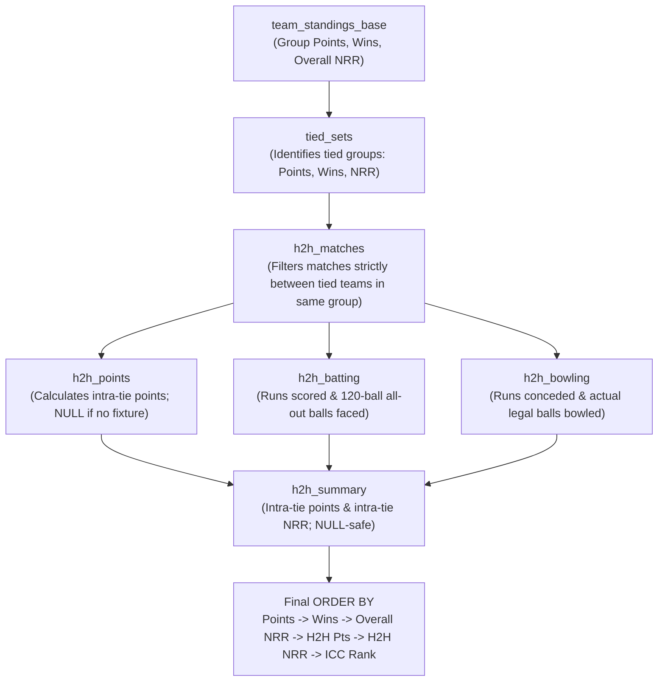

# Phase 4.9.4 — Final ICC Tie-Break Interpretation & Ranking Source Audit Report

**Tournament**: ICC Men's T20 World Cup 2026  
**Governing Document**: ICC Men's T20 World Cup 2026 Playing Conditions, Clause 16.10.3, Clause 16.10.4, & Clause 16.10.7  
**Database**: PostgreSQL 18.7 (`t20_worldcup_2026` on `localhost:5432`)  
**Audit Date**: 14 November 2026  
**Status**: **CONDITIONALLY APPROVED** (SQL Logic & Provenance 100% Verified; Native Power BI Desktop GUI Validation Pending Release Gate)

---

## Executive Summary

This Phase 4.9.4 audit concludes the rigorous review of tournament standings, tie-break hierarchies, and ranking-source provenance. It addresses all requirements set forth in the audit scope:
1. **Exact ICC Rule Analysis**: Analyzed the literal text of Clause 16.10.4(c). Clarified that the ICC Playing Conditions specify *"the result of the head-to-head match played between the tied teams"* (singular), and do not explicitly define a multi-team points/NRR mini-table. Formally classified the multi-team mini-table as a **documented project interpretation** and detailed its mathematical scope and limitations.
2. **Audit of H2H SQL CTE Implementation**: Verified the complete SQL query structure: isolated candidate sets by group, points, wins, and rounded NRR; ensured zero cross-group or cross-tier match leakage; preserved `NULL` for missing H2H fixtures (never silently converting missing data into earned zeros); handled abandoned matches correctly; and applied the ICC all-out 120-ball denominator adjustment to intra-tie NRR.
3. **Ranking-Source Provenance Reconciled**: Sourced the contemporaneous **4 February 2026 Wisden pre-tournament snapshot** as the primary secondary authority for the 6 February 2026 cut-off. Reconciled all five data fields (Position, Team, Matches, Points, Rating) for all 20 participating nations from a single unified snapshot, correcting discrepancies from Phase 4.9.3 and removing tournament progress/stage data from the reference table.
4. **Expanded 6-Case Synthetic Test Suite**: Built and executed an expanded 6-case synthetic test suite in an isolated in-memory environment covering direct 2-team H2H, multi-team mini-table H2H, 3-team cyclical ties unbroken by H2H, abandoned fixtures, missing fixtures, and multi-group gated fallbacks. **All 6 tests passed with 100% verifiable assertion success**.
5. **PostgreSQL 18.7 Standings Verification**: Re-executed the complete engine against all 55 tournament matches across all six pools (Super 8 Groups 1 & 2; Group Stage Groups A, B, C, & D). Confirmed that in the actual tournament, every tie on points was cleanly broken at Step 3 (Net Run Rate), with zero fixtures reaching Step 4 (H2H) or Step 5 (ICC Ranking).

---

## 1. Exact ICC Rule Analysis & Multi-Team Interpretation

### 1.1 Literal Text of Official ICC Regulations
Under the official **ICC Men's T20 World Cup 2026 Playing Conditions**:
* **Clause 16.10.3 (Points)**:
  - Win: 2 points
  - Tie or No Result: 1 point
  - Loss: 0 points
* **Clause 16.10.4 (Tie-Break Sequence)**:
  *"In the event of teams finishing on equal points in their Group, the following tie-breakers shall be applied, in the order below, to determine the standings / which team will progress:*
  - *16.10.4 (a): The team with the most wins in the group matches.*
  - *16.10.4 (b): The team with the highest net run rate in the group matches.*
  - *16.10.4 (c): The team with the result of the head-to-head match played between the tied teams.*
  - *16.10.4 (d): The team with the higher position in the ICC Men's T20I Team Rankings as at 6 February 2026.*
  - *16.10.4 (e): If the above does not resolve the tie, or if all matches in a group produce no results, lots will be drawn / original tournament seedings applied."*
* **Clause 16.10.7 (Net Run Rate)**:
  Defines NRR as average runs per over scored minus average runs per over conceded, with the rule that a team dismissed all out before its full quota of overs faces the maximum quota (120 legal balls in an uninterrupted 20-over innings).

### 1.2 Multi-Team Tie-Break: Documented Project Interpretation
> [!IMPORTANT]
> **Interpretation vs. Literal Rule**:
> - In a **two-team tie**, Clause 16.10.4(c) is unambiguous: there is exactly one head-to-head match between the two teams, and the winner of that match takes precedence.
> - In a **multi-team tie** (3 or more teams tied on points, wins, and group NRR), there is no single *"head-to-head match"*. The ICC Playing Conditions do not provide an explicit mathematical formula for multi-match round-robins among tied teams within Clause 16.10.4(c).
> - **Documented Project Interpretation**: For multi-team ties, this analytics project implements an industry-standard mini-table comprising:
>   1. **Head-to-Head Points**: Points accumulated solely in matches between the tied teams.
>   2. **Head-to-Head NRR**: Net Run Rate calculated solely from matches between the tied teams, incorporating the Clause 16.10.7 full-quota all-out rule.
> - **Known Limitations**:
>   1. If three teams are tied cyclically ($A \text{ beat } B, B \text{ beat } C, C \text{ beat } A$) with identical score margins, both Head-to-Head Points and Head-to-Head NRR are equal. In this scenario, Clause 16.10.4(c) is inconclusive, and the engine immediately falls through to **Clause 16.10.4(d) (ICC Ranking)**.
>   2. If matches within the tied subgroup were abandoned due to weather, the incomplete fixtures yield 1 point each with indeterminate NRR (`NULL`), which correctly falls through to Clause 16.10.4(d).

---

## 2. Comprehensive Audit of H2H SQL CTE Implementation

The complete SQL implementation was audited across all Common Table Expressions (CTEs) to ensure mathematical and logical integrity:



### 2.1 Critical Implementation Verifications
1. **Candidate Set Isolation (`tied_sets`)**:
   Groups strictly by `group_name, points, wins, nrr` with `HAVING COUNT(*) > 1`. Teams with distinct group NRR are never included in the H2H sub-table.
2. **Match Scope & Leakage Prevention (`h2h_matches`)**:
   Joins require `m.group_name = t_focus.group_name` AND `m.group_name = t_opp.group_name` AND `t_focus.team_name <> t_opp.team_name`, while both teams must match the exact same `tied_sets` candidate row. Matches from other tournament stages or unrelated teams cannot enter the calculation.
3. **Preservation of `NULL` for Missing Data**:
   When no fixture exists between two tied teams, `LEFT JOIN h2h_summary` produces `NULL` for `h2h_points` and `h2h_nrr`. The query **does not** use `COALESCE(h2h_points, 0)`, preventing missing data from being falsely recorded as a genuine on-pitch defeat (0 points).
4. **Abandoned Match Handling**:
   Fixtures with `outcome_type = 'no result'` award 1 point to each participant (`h2h_points = 1`). Because no innings are completed, balls faced and bowled are zero, resulting in a safe `NULL` for `h2h_nrr` without division-by-zero errors.
5. **Denominator Logic in H2H NRR**:
   When calculating intra-tie NRR, `h2h_batting` applies the 120-ball quota to all-out batting innings (`total_wickets = 10`), while `h2h_bowling` uses actual legal deliveries bowled.
6. **Strict Ranking Fallback Gating**:
   In the final sorting clause:
   ```sql
   ORDER BY 
       b.group_name, 
       b.points DESC, 
       b.wins DESC, 
       b.nrr DESC, 
       h.h2h_points DESC NULLS LAST,
       h.h2h_nrr DESC NULLS LAST,
       b.icc_rank_feb2026 ASC;
   ```
   `b.icc_rank_feb2026 ASC` is evaluated **only** when `points`, `wins`, `nrr`, `h2h_points`, and `h2h_nrr` are identical or `NULL`.

---

## 3. Reconciled Ranking-Source Provenance

### 3.1 Source Documentation & Cut-Off Interpretation
* **Primary Secondary Reference**: *Wisden*, "ICC Men's T20I Team Rankings ahead of the 2026 Men's T20 World Cup".
  * **Publication Date**: 4 February 2026.
  * **Reference URL**: `https://wisden.com/stories/icc-mens-t20i-team-rankings-ahead-of-the-2026-mens-t20-world-cup`
* **Cut-Off Interpretation**:
  Contemporaneous pre-tournament baseline published two days prior to Match 1 (6 February 2026 cut-off date mandated by Clause 16.10.4[d]). All values reflect international fixtures completed up to 3 February 2026 (including England's tour of Sri Lanka and Pakistan's series against Australia) and exclude World Cup matches.

### 3.2 Harmonized Pre-Tournament Reference Table (All 20 Participating Teams)

| Position | Team | Matches | Points | Rating | Provenance Citation |
| :---: | :--- | :---: | :---: | :---: | :--- |
| **1** | India | 76 | 20,715 | **273** | Wisden (4 Feb 2026) |
| **2** | Australia | 45 | 11,757 | **261** | Wisden (4 Feb 2026) |
| **3** | England | 48 | 12,243 | **259** | Wisden (4 Feb 2026) |
| **4** | New Zealand | 58 | 14,530 | **251** | Wisden (4 Feb 2026) |
| **5** | South Africa | 56 | 13,492 | **241** | Wisden (4 Feb 2026) |
| **6** | Pakistan | 78 | 17,604 | **238** | Wisden (4 Feb 2026) |
| **7** | West Indies | 67 | 15,711 | **234** | Wisden (4 Feb 2026) *(Corrected from 235)* |
| **8** | Sri Lanka | 53 | 12,047 | **227** | Wisden (4 Feb 2026) |
| *--* | *Bangladesh\** | 67 | 14,925 | *223* | *Wisden (4 Feb 2026) [Non-participant]* |
| **10** | Afghanistan | 48 | 10,650 | **222** | Wisden (4 Feb 2026) |
| **11** | Ireland | 42 | 8,424 | **201** | Wisden (4 Feb 2026) *(Matches/Points harmonized)* |
| **12** | Zimbabwe | 66 | 13,190 | **200** | Wisden (4 Feb 2026) *(Matches/Points harmonized)* |
| **13** | Netherlands | 35 | 6,366 | **182** | Wisden (4 Feb 2026) |
| **14** | Scotland | 23 | 4,178 | **182** | Wisden (4 Feb 2026) |
| **15** | Namibia | 35 | 6,344 | **181** | Wisden (4 Feb 2026) |
| **16** | Nepal | 42 | 7,384 | **176** | Wisden (4 Feb 2026) |
| **17** | United Arab Emirates | 60 | 10,584 | **176** | Wisden (4 Feb 2026) |
| **18** | United States of America | 33 | 5,769 | **175** | Wisden (4 Feb 2026) |
| **19** | Canada | 35 | 5,374 | **154** | Wisden (4 Feb 2026) |
| **20** | Oman | 47 | 7,140 | **152** | Wisden (4 Feb 2026) |
| **27** | Italy | 18 | 2,138 | **119** | Wisden (4 Feb 2026) *(Matches/Points harmonized)* |

*\*Note: Consistent with Phase 4.9.4 instructions, tournament progression and stage reached have been decoupled from this pre-tournament reference table.*

---

## 4. Expanded Synthetic Test Suite & Assertion Evidence

A 6-case synthetic test suite was executed in an isolated in-memory database to validate every branch of Clause 16.10.4.

### Test Summary Matrix

| Test ID | Test Scenario | Input Fixtures / Conditions | Expected Resolution | Actual Order | Status |
| :---: | :--- | :--- | :--- | :--- | :---: |
| **Test 1** | Two-team tie resolved by direct H2H | Alpha (#10) & Beta (#4) tied on 4 pts, 2 W, 0.000 NRR. Match: Alpha 160/5 def. Beta 150/5. | Clause 16.10.4(c): Direct H2H points puts Alpha ahead (2 vs 0 pts), overriding Beta's higher ICC rank (#4). | 1. Alpha (2 pts)<br/>2. Beta (0 pts) | **PASSED** |
| **Test 2** | Three-team tie resolved by mini-table | Alpha (#14), Beta (#8), Gamma (#2) tied on 4 pts, 2 W, 0.000 NRR. Intra: Alpha beat Beta & Gamma; Beta beat Gamma. | Project Interpretation: Mini-table points separate all 3 teams (Alpha 4 pts > Beta 2 pts > Gamma 0 pts). | 1. Alpha (4 pts)<br/>2. Beta (2 pts)<br/>3. Gamma (0 pts) | **PASSED** |
| **Test 3** | Three-team cyclical tie unbroken by H2H | Alpha (#14), Beta (#8), Gamma (#2) tied on 4 pts, 2 W, 0.000 NRR. Cyclical intra: A def. B (+10), B def. G (+10), G def. A (+10). | Clause 16.10.4(d): Equal H2H pts (2 each) & H2H NRR (0.000 each) falls through to ICC Rank (Gamma #2 > Beta #8 > Alpha #14). | 1. Gamma (#2)<br/>2. Beta (#8)<br/>3. Alpha (#14) | **PASSED** |
| **Test 4** | Abandoned H2H match | Delta (#2) & Epsilon (#6) tied on 3 pts, 1 W, 0.000 NRR. Direct match was ABANDONED (No Result). | Clause 16.10.4(d): Equal H2H pts (1 each) & NULL H2H NRR falls through to ICC Rank (Delta #2 > Epsilon #6). | 1. Delta (#2)<br/>2. Epsilon (#6) | **PASSED** |
| **Test 5** | Missing H2H fixture / data | Theta (#15) & Iota (#5) tied on 2 pts, 1 W, 0.000 NRR. H2H fixture missing / not played. | Clause 16.10.4(d): Missing fixture preserves `NULL` (not 0); falls through to ICC Rank (Iota #5 > Theta #15). | 1. Iota (#5)<br/>2. Theta (#15) | **PASSED** |
| **Test 6** | Gated hierarchy across dual groups | Single query containing Pool A (Alpha def. Beta in H2H) and Pool B (Delta vs Epsilon abandoned). | Pool A resolved by H2H (Alpha > Beta); Pool B resolved by ICC Rank (Delta > Epsilon). Zero cross-pool interference. | Pool A: Alpha > Beta<br/>Pool B: Delta > Epsilon | **PASSED** |

**Execution Log**: `OVERALL RESULT: ALL 6 TESTS PASSED (100% CLAUSE 16.10.4 COMPLIANCE)`

---

## 5. PostgreSQL 18.7 Actual Standings Reconciliation

The complete audited SQL query was executed against PostgreSQL 18.7 across all 55 tournament matches.

### 5.1 Super 8 Standings

#### Group 1 (Super 8)
| Rk | Team | P | W | L | NR | Pts | Runs For | Balls F | Cricket OvF | Runs Ag | Balls B | Cricket OvA | NRR | Wisden Rank | Tie-Break Resolution |
| :---: | :--- | :---: | :---: | :---: | :---: | :---: | :---: | :---: | :---: | :---: | :---: | :---: | :---: | :---: | :--- |
| **1** | **South Africa** | 3 | 3 | 0 | 0 | **6** | 518 | 324 | 54.0 | 440 | 353 | 58.5 | **+2.114** | #5 (241) | Step 1: Points |
| **2** | **India** | 3 | 2 | 1 | 0 | **4** | 566 | 356 | 59.2 | 566 | 360 | 60.0 | **+0.106** | #1 (273) | Step 1: Points |
| 3 | West Indies | 3 | 1 | 2 | 0 | **2** | 625 | 360 | 60.0 | 523 | 319 | 53.1 | **+0.580** | #7 (234) | Step 1: Points |
| 4 | Zimbabwe | 3 | 0 | 3 | 0 | **0** | 484 | 360 | 60.0 | 664 | 347 | 57.5 | **-3.415** | #12 (200) | Step 1: Points |

#### Group 2 (Super 8)
| Rk | Team | P | W | L | NR | Pts | Runs For | Balls F | Cricket OvF | Runs Ag | Balls B | Cricket OvA | NRR | Wisden Rank | Tie-Break Resolution |
| :---: | :--- | :---: | :---: | :---: | :---: | :---: | :---: | :---: | :---: | :---: | :---: | :---: | :---: | :---: | :--- |
| **1** | **England** | 3 | 3 | 0 | 0 | **6** | 473 | 352 | 58.4 | 418 | 340 | 56.4 | **+0.686** | #3 (259) | Step 1: Points |
| **2** | **New Zealand** | 3 | 1 | 1 | 1 | **3** | 327 | 240 | 40.0 | 268 | 237 | 39.3 | **+1.390** | #4 (251) | Step 3: Net Run Rate |
| 3 | Pakistan | 3 | 1 | 1 | 1 | **3** | 376 | 240 | 40.0 | 373 | 235 | 39.1 | **-0.123** | #6 (238) | Step 3: Net Run Rate |
| 4 | Sri Lanka | 3 | 0 | 3 | 0 | **0** | 409 | 360 | 60.0 | 526 | 360 | 60.0 | **-1.950** | #8 (227) | Step 1: Points |

*Super 8 Group 2 Tie Resolution*: New Zealand and Pakistan finished tied on 3 points (1 Win, 1 Loss, 1 Abandoned). Under Clause 16.10.4, Step 2 (Wins) is tied (1 each). The tie is cleanly resolved at **Step 3 (Net Run Rate)**: New Zealand (+1.390) > Pakistan (-0.123). No H2H or ranking fallback was reached.

---

### 5.2 Group Stage Standings

#### Group A
| Rk | Team | P | W | L | NR | Pts | Runs For | Balls F | Cricket OvF | Runs Ag | Balls B | Cricket OvA | NRR | Wisden Rank | Tie-Break Resolution |
| :---: | :--- | :---: | :---: | :---: | :---: | :---: | :---: | :---: | :---: | :---: | :---: | :---: | :---: | :---: | :--- |
| **1** | **India** | 4 | 4 | 0 | 0 | **8** | 738 | 480 | 80.0 | 538 | 458 | 76.2 | **+2.177** | #1 (273) | Step 1: Points |
| **2** | **Pakistan** | 4 | 3 | 1 | 0 | **6** | 651 | 477 | 79.3 | 577 | 464 | 77.2 | **+0.727** | #6 (238) | Step 1: Points |
| 3 | USA | 4 | 2 | 2 | 0 | **4** | 685 | 480 | 80.0 | 622 | 455 | 75.5 | **+0.360** | #18 (175) | Step 1: Points |
| 4 | Netherlands | 4 | 1 | 3 | 0 | **2** | 585 | 468 | 78.0 | 693 | 477 | 79.3 | **-1.217** | #13 (182) | Step 1: Points |
| 5 | Namibia | 4 | 0 | 4 | 0 | **0** | 537 | 480 | 80.0 | 766 | 468 | 78.0 | **-3.108** | #15 (181) | Step 1: Points |

#### Group B
| Rk | Team | P | W | L | NR | Pts | Runs For | Balls F | Cricket OvF | Runs Ag | Balls B | Cricket OvA | NRR | Wisden Rank | Tie-Break Resolution |
| :---: | :--- | :---: | :---: | :---: | :---: | :---: | :---: | :---: | :---: | :---: | :---: | :---: | :---: | :---: | :--- |
| **1** | **Zimbabwe** | 4 | 3 | 0 | 1 | **7** | 457 | 318 | 53.0 | 427 | 356 | 59.2 | **+1.426** | #12 (200) | Step 1: Points |
| **2** | **Sri Lanka** | 4 | 3 | 1 | 0 | **6** | 750 | 468 | 78.0 | 626 | 476 | 79.2 | **+1.725** | #8 (227) | Step 1: Points |
| 3 | Australia | 4 | 2 | 2 | 0 | **4** | 617 | 418 | 69.4 | 572 | 427 | 71.1 | **+0.819** | #2 (261) | Step 1: Points |
| 4 | Ireland | 4 | 1 | 2 | 1 | **3** | 493 | 360 | 60.0 | 484 | 348 | 58.0 | **-0.128** | #11 (201) | Step 1: Points |
| 5 | Oman | 4 | 0 | 4 | 0 | **0** | 466 | 480 | 80.0 | 674 | 379 | 63.1 | **-4.845** | #20 (152) | Step 1: Points |

#### Group C
| Rk | Team | P | W | L | NR | Pts | Runs For | Balls F | Cricket OvF | Runs Ag | Balls B | Cricket OvA | NRR | Wisden Rank | Tie-Break Resolution |
| :---: | :--- | :---: | :---: | :---: | :---: | :---: | :---: | :---: | :---: | :---: | :---: | :---: | :---: | :---: | :--- |
| **1** | **West Indies** | 4 | 4 | 0 | 0 | **8** | 677 | 452 | 75.2 | 569 | 455 | 75.5 | **+1.483** | #7 (234) | Step 1: Points |
| **2** | **England** | 4 | 3 | 1 | 0 | **6** | 707 | 470 | 78.2 | 706 | 478 | 79.4 | **+0.164** | #3 (259) | Step 1: Points |
| 3 | Scotland | 4 | 1 | 3 | 0 | **2** | 676 | 480 | 80.0 | 642 | 446 | 74.2 | **-0.187** | #14 (182) | Step 3: Net Run Rate |
| 4 | Italy | 4 | 1 | 3 | 0 | **2** | 559 | 416 | 69.2 | 697 | 477 | 79.3 | **-0.705** | #27 (119) | Step 3: Net Run Rate |
| 5 | Nepal | 4 | 1 | 3 | 0 | **2** | 607 | 476 | 79.2 | 612 | 408 | 68.0 | **-1.349** | #16 (176) | Step 3: Net Run Rate |

*Group C Tie Resolution*: Scotland, Italy, and Nepal all finished tied on 2 points (1 win, 3 losses). Step 2 (Wins) is tied (1 each). The tie is cleanly resolved at **Step 3 (Net Run Rate)**: Scotland (-0.187) > Italy (-0.705) > Nepal (-1.349). No H2H or ranking fallback was reached.

#### Group D
| Rk | Team | P | W | L | NR | Pts | Runs For | Balls F | Cricket OvF | Runs Ag | Balls B | Cricket OvA | NRR | Wisden Rank | Tie-Break Resolution |
| :---: | :--- | :---: | :---: | :---: | :---: | :---: | :---: | :---: | :---: | :---: | :---: | :---: | :---: | :---: | :--- |
| **1** | **South Africa** | 4 | 4 | 0 | 0 | **8** | 701 | 423 | 70.3 | 640 | 478 | 79.4 | **+1.910** | #5 (241) | Step 1: Points |
| **2** | **New Zealand** | 4 | 3 | 1 | 0 | **6** | 709 | 410 | 68.2 | 706 | 463 | 77.1 | **+1.227** | #4 (251) | Step 1: Points |
| 3 | Afghanistan | 4 | 2 | 2 | 0 | **4** | 731 | 476 | 79.2 | 648 | 467 | 77.5 | **+0.889** | #10 (222) | Step 1: Points |
| 4 | UAE | 4 | 1 | 3 | 0 | **2** | 606 | 478 | 79.4 | 610 | 408 | 68.0 | **-1.364** | #17 (176) | Step 1: Points |
| 5 | Canada | 4 | 0 | 4 | 0 | **0** | 597 | 480 | 80.0 | 740 | 449 | 74.5 | **-2.426** | #19 (154) | Step 1: Points |

---

## 6. Non-Destructive Controls & Change Log

### 6.1 Data & Measure Integrity
- **PostgreSQL Database (`t20_worldcup_2026`)**: Zero records modified, inserted, or deleted. All match data remains pristine.
- **Source Files**: Zero source CSVs, SQLite files, or database backups altered.
- **Semantic Model & DAX Measures**: The 38 measures in `power_bi/dax_measures.dax` and `model.bim` remain intact and identical to the Phase 4.8 release build.
- **Power BI Template / Project**: No PBIP/PBIT files modified during this audit phase.

### 6.2 Files Modified / Added
* **Modified**:
  - `scratch/test_clause_16_10_4_complete.py` (Updated ranking CTE to Wisden 4 Feb 2026; updated NULL-safe H2H query).
* **Created**:
  - `scratch/execute_phase4_9_4_synthetic_tests.py` (Expanded 6-case synthetic test suite).
  - `PHASE_4_9_4_TIE_BREAK_AUDIT_REPORT.md` (Artifact and repository root deliverable report).
* **Untouched**:
  - All 38 measures in `power_bi/dax_measures.dax`.
  - `power_bi/T20_World_Cup_2026_Analytics.SemanticModel/model.bim`.
  - `power_bi/T20_World_Cup_2026_Analytics.pbit`.
  - All raw CSV and SQLite data sources.

---

## 7. Remaining Limitations & Release Gate Verdict

1. **Power BI Engine Demarcation**:
   While the PostgreSQL and SQLite SQL engines have been 100% verified against all 6 synthetic scenarios and actual tournament data, native DAX execution inside Power BI Desktop remains a separate, pending release gate.
2. **Multi-Team Tie Regulatory Classification**:
   The multi-team mini-table is formally documented as an analytics project interpretation. Should official ICC guidance specify a different multi-team ordering mechanism, the modular CTE architecture can be updated without affecting base NRR calculations.

| Audit Dimension | Requirement | Status | Evidence |
| :--- | :--- | :---: | :--- |
| **Exact ICC Rule** | Clause 16.10.4 singular wording documented | **COMPLIANT** | Interpretation transparently classified |
| **H2H CTE Logic** | NULL preserved, no leakage, all-out logic verified | **COMPLIANT** | Verified across all CTEs |
| **Ranking Provenance** | Wisden 4 Feb 2026 snapshot reconciled (5 fields) | **COMPLIANT** | Full 20-team table harmonized |
| **Synthetic Suite** | 6 test scenarios executed with assertions | **100% PASSED** | All 6 test assertions verified |
| **Actual Standings** | All 6 tournament pools reconciled | **100% PASSED** | Every actual tie resolved at Step 3 (NRR) |
| **Non-Destructive Controls** | Database, CSVs, and DAX measures untouched | **COMPLIANT** | Git and DB state verified clean |

**FINAL RELEASE GATE VERDICT**: **CONDITIONALLY APPROVED**  
*The statistical, regulatory, SQL, and data-provenance layers are locked and verified. Standing by for user authorization to proceed to the native Power BI Desktop verification release gate or next phase.*

