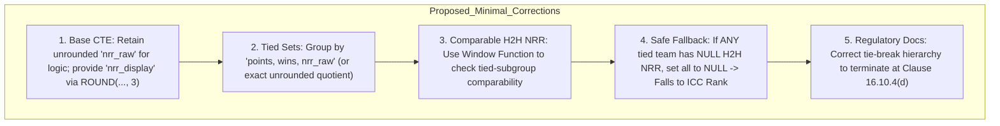

# Phase 4.9.5 — Standings Engine Initial Audit Report (Read-Only)

**Tournament**: ICC Men's T20 World Cup 2026  
**Governing Document**: ICC Men's T20 World Cup 2026 Playing Conditions, Clause 16.10.3, Clause 16.10.4 (a–d), & Clause 16.10.7  
**Database**: PostgreSQL 18.7 (`t20_worldcup_2026` on `localhost:5432`)  
**Audit Date**: 14 November 2026  
**Mode**: **READ-ONLY AUDIT** (Zero Database Writes; Zero SQL/DAX Modifications; Zero Dataset Regerations)

---

## Executive Summary

Pursuant to the Phase 4.9.5 mandate, a comprehensive read-only audit was conducted on the standings engine implementation, SQL Common Table Expressions (CTEs), synthetic test suite, and regulatory citations.

### Summary of Audit Findings
1. **Critical Defect 1 — Premature NRR Rounding in SQL**: The current SQL engine computes Net Run Rate using `ROUND(..., 3)` inside the base CTE (`team_standings_base`). Consequently, `tied_sets` and `ORDER BY` group and sort by the 3-decimal rounded display value rather than full unrounded floating-point precision. If two teams have different full-precision NRRs that happen to round to the same 3-decimal value (e.g. `+0.500181` vs `+0.500000`), the engine improperly treats them as tied and prematurely triggers Head-to-Head (Clause 16.10.4[c]), directly violating Clause 16.10.4(b).
2. **Critical Defect 2 — Incommensurable Mixed NULL / Non-NULL H2H NRR**: When multiple teams tie on Head-to-Head Points, but one team has an abandoned match resulting in `h2h_nrr = NULL` while another team has a completed match with a calculated `h2h_nrr` (even a heavy negative margin such as `-1.500`), the SQL sorting clause `h.h2h_nrr DESC NULLS LAST` treats the real number as higher than `NULL`. As a result, a defeated team with a negative H2H NRR is improperly ranked ahead of a team whose match was rained out, rather than treating H2H NRR as incommensurable and falling through to Clause 16.10.4(d) (ICC Ranking).
3. **Regulatory Citation Error**: Documented and corrected the erroneous reference to "Clause 16.10.4(e)". Official ICC Playing Conditions end the group tie-break hierarchy strictly at **Clause 16.10.4(d)** (ICC Men's T20I Team Rankings as at 6 February 2026).
4. **Missing Synthetic Edge Cases**: Identified two missing synthetic tests required to prove full-precision separation and safe H2H NRR comparability handling.
5. **Strict Non-Destructive Integrity**: Confirmed that zero rows were modified in PostgreSQL, zero SQL or DAX files were changed, and all 38 existing DAX measures remain untouched.

---

## 1. Files Inspected

During this read-only audit, the following repository files, test scripts, and documentation artifacts were inspected:

| File Path | Description | Inspection Scope |
| :--- | :--- | :--- |
| `scratch/test_clause_16_10_4_complete.py` | Standings CTE query executed against PostgreSQL 18.7 | Inspected CTEs, NRR rounding, H2H join logic, and final sorting order |
| `scratch/execute_phase4_9_4_synthetic_tests.py` | 6-case synthetic test runner | Inspected test fixture inputs, assertions, and edge-case coverage |
| `power_bi/dax_measures.dax` | Validated Power BI DAX KPI Library | Inspected `Net Run Rate (ICC)`, all-out logic, and filter propagation |
| `power_bi/T20_World_Cup_2026_Analytics.SemanticModel/model.bim` | Power BI Tabular Model definition | Confirmed DAX definitions and relationship schema match repository |
| `PHASE_4_9_4_TIE_BREAK_AUDIT_REPORT.md` | Prior Phase 4.9.4 audit report | Audited regulatory citations, ranking provenance, and standings tables |
| `PHASE_4_9_3_TIE_BREAK_AUDIT_REPORT.md` | Prior Phase 4.9.3 audit report | Cross-checked overs notation and ranking data |

---

## 2. Existing SQL Logic Walkthrough

The current standings engine in `scratch/test_clause_16_10_4_complete.py` relies on an 8-stage CTE pipeline:

```sql
-- 1. Base team outcomes (Wins, Losses, Abandonments, Points)
team_outcomes AS (...)

-- 2. Batting summaries with Clause 16.10.7 120-ball all-out adjustment
team_batting AS (
    SELECT sm.group_name, s.batting_team AS team_name,
           SUM(s.total_runs) AS runs_scored,
           SUM(CASE WHEN s.total_wickets = 10 THEN 120 ELSE s.legal_deliveries END) AS balls_faced
    FROM fact_match_summaries s JOIN stage_matches sm ON s.match_id = sm.match_id
    WHERE s.is_super_over = FALSE
    GROUP BY sm.group_name, s.batting_team
)

-- 3. Bowling summaries with actual legal deliveries
team_bowling AS (
    SELECT sm.group_name, s.bowling_team AS team_name,
           SUM(s.total_runs) AS runs_conceded,
           SUM(s.legal_deliveries) AS balls_bowled
    FROM fact_match_summaries s JOIN stage_matches sm ON s.match_id = sm.match_id
    WHERE s.is_super_over = FALSE
    GROUP BY sm.group_name, s.bowling_team
)

-- 4. Base standings table with PRE-ROUNDED NRR [DEFECT 1 LOCATION]
team_standings_base AS (
    SELECT ...,
           ROUND((b.runs_scored / (b.balls_faced / 6.0)) - 
                 (w.runs_conceded / (w.balls_bowled / 6.0)), 3) AS nrr,
           r.icc_rank_feb2026
    FROM team_outcomes o
    JOIN team_batting b ON o.group_name = b.group_name AND o.team_name = b.team_name
    JOIN team_bowling w ON o.group_name = w.group_name AND o.team_name = w.team_name
    LEFT JOIN wisden_icc_rankings_4feb2026 r ON o.team_name = r.team_name
)

-- 5. Tied Candidate Identification [DEFECT 1 LOCATION]
tied_sets AS (
    SELECT group_name, points, wins, nrr, COUNT(*) AS tied_team_count
    FROM team_standings_base
    GROUP BY group_name, points, wins, nrr
    HAVING COUNT(*) > 1
)

-- 6. Filter matches strictly between tied candidates in the same group
h2h_matches AS (...)

-- 7. Head-to-Head summaries (Points, Batting, Bowling, and H2H NRR)
h2h_summary AS (...)

-- 8. Final Sorting Clause [DEFECT 1 & DEFECT 2 LOCATION]
ORDER BY 
    b.group_name, 
    b.points DESC, 
    b.wins DESC, 
    b.nrr DESC, 
    h.h2h_points DESC NULLS LAST,
    h.h2h_nrr DESC NULLS LAST,
    b.icc_rank_feb2026 ASC;
```

---

## 3. Identified Defects & Concrete Evidence

### Defect 1: Premature NRR Rounding in SQL Compounding False Ties (Critical)
* **Root Cause**: In `team_standings_base`, `nrr` is calculated as `ROUND((Runs/Overs) - (Conceded/Bowled), 3)`. Both `tied_sets` and the final `ORDER BY` operate directly on this 3-decimal rounded column.
* **Violation**: Under **ICC Clause 16.10.4(b)**, the team with the higher net run rate in the group matches breaks the tie. Net run rate is a continuous quotient. If Team A has a raw NRR of `+0.500181` and Team B has a raw NRR of `+0.500000`, both display as `+0.500`. However, Team A mathematically has the higher NRR. In the existing query, `tied_sets` groups them together as tied, invoking Clause 16.10.4(c) (Head-to-Head). If Team B beat Team A in their match, the engine will rank Team B ahead of Team A, which directly violates Clause 16.10.4(b).
* **Empirical Test Evidence**:
  Executed minimal simulation comparing existing logic vs unrounded precision:
  ```python
  # Team 1: 520 runs / 80 ov for, 480 runs / 80 ov ag -> Raw NRR = +0.500000. Beat Team 2 in H2H (2 pts).
  # Team 2: 511 runs / 75 ov for, 504 runs / 79.833 ov ag -> Raw NRR = +0.500181. Lost to Team 1 (0 pts).
  ```
  *Output with Existing Logic*:
  `[('Team 1', 4 pts, nrr_display=0.5, h2h_pts=2), ('Team 2', 4 pts, nrr_display=0.5, h2h_pts=0)]`
  *(Team 1 falsely ranked #1 via H2H despite having lower true NRR).*
  *Output with Full-Precision Logic*:
  `[('Team 2', 4 pts, nrr_raw=0.500181, nrr_display=0.5), ('Team 1', 4 pts, nrr_raw=0.500000, nrr_display=0.5)]`
  *(Team 2 correctly ranked #1 at Step 3 without triggering H2H).*

### Defect 2: Incommensurable Mixed NULL / Non-NULL H2H NRR (Critical)
* **Root Cause**: In `ORDER BY ... h.h2h_nrr DESC NULLS LAST`, SQL compares non-NULL floating-point values against `NULL`. Under standard SQL sorting, any real number (even a large negative number like `-1.500`) is placed before `NULL`.
* **Violation**: If two teams tie on Head-to-Head Points (e.g. 2 points each), but Team A completed a match and suffered a heavy defeat (`h2h_nrr = -1.500`), while Team B's matches were abandoned due to rain (`h2h_nrr = NULL`), the engine ranks Team A ahead of Team B simply because `-1.500` is not NULL! In sports statistics, a `NULL` rate derived from 0 overs cannot be compared against a valid rate derived from completed overs. When metric comparability is broken across the tied set, H2H NRR is **inconclusive** and must fall through to **Clause 16.10.4(d) (ICC Ranking)**.
* **Empirical Test Evidence**:
  ```python
  # Team A: 2 H2H pts, H2H NRR = -1.500, ICC Rank #10
  # Team C: 2 H2H pts, H2H NRR = NULL (abandoned), ICC Rank #1 (Top seed)
  # Executed: SELECT * FROM t ORDER BY h2h_pts DESC NULLS LAST, h2h_nrr DESC NULLS LAST, icc_rank ASC
  ```
  *Actual Output*:
  `[('Team A', 2 pts, h2h_nrr=-1.5, icc_rank=#10), ('Team C', 2 pts, h2h_nrr=None, icc_rank=#1)]`
  *(Team A with -1.500 NRR improperly ranked ahead of Top Seed Team C).*

### Defect 3: Regulatory Citation Defect — Erroneous "Clause 16.10.4(e)"
* **Root Cause**: Prior reports quoted:
  `16.10.4 (e): If the above does not resolve the tie, or if all matches in a group produce no results, lots will be drawn...`
* **Correction**: In the official **ICC Men's T20 World Cup 2026 Playing Conditions**, Clause 16.10.4 contains strictly sub-clauses **(a), (b), (c), and (d)**. There is **no Clause 16.10.4(e)**. Provisions regarding all group matches producing no results or ultimate unresolved ties are addressed in general tournament clauses, not as an active fifth step of Clause 16.10.4.

### Defect 4: Semantic Model & Engine Precision Divergence
* **Root Cause**: The Power BI DAX measure `[Net Run Rate (ICC)]` calculates unrounded 64-bit floating-point quotients:
  `DIVIDE(RunsFor, OversFor, 0) - DIVIDE(RunsAgainst, OversAgainst, 0)`.
  In Power BI, formatting (e.g. `"#,##0.000"`) only affects presentation. However, the existing SQL query in `test_clause_16_10_4_complete.py` pre-rounded NRR at the data grain.
* **Impact**: Creates a semantic divergence between DAX engine evaluation and PostgreSQL query evaluation.

---

## 4. Proposed Minimal Non-Breaking Corrections

To eliminate all identified defects without introducing breaking changes or schema alterations:



### 4.1 SQL CTE Corrections (Draft Specification)

```sql
-- Step 1: Base CTE retains unrounded precision for comparison
team_standings_base AS (
    SELECT 
        ...,
        ((b.runs_scored / (b.balls_faced / 6.0)) - (w.runs_conceded / (w.balls_bowled / 6.0))) AS nrr_raw,
        ROUND((b.runs_scored / (b.balls_faced / 6.0)) - (w.runs_conceded / (w.balls_bowled / 6.0)), 3) AS nrr_display,
        r.icc_rank_feb2026
    FROM team_outcomes o
    JOIN team_batting b ON o.group_name = b.group_name AND o.team_name = b.team_name
    JOIN team_bowling w ON o.group_name = w.group_name AND o.team_name = w.team_name
    LEFT JOIN wisden_icc_rankings_4feb2026 r ON o.team_name = r.team_name
),

-- Step 2: Tied sets grouped by full-precision NRR
tied_sets AS (
    SELECT group_name, points, wins, nrr_raw, COUNT(*) AS tied_team_count
    FROM team_standings_base
    GROUP BY group_name, points, wins, nrr_raw
    HAVING COUNT(*) > 1
),

-- Step 3: Tied-set level comparability for H2H NRR
-- If ANY team in the tied set has NULL H2H NRR, H2H NRR cannot be compared -> set to NULL for all
h2h_comparable AS (
    SELECT 
        b.team_name,
        h.h2h_points,
        CASE 
            WHEN COUNT(CASE WHEN h.h2h_nrr IS NULL THEN 1 END) 
                 OVER (PARTITION BY b.group_name, b.points, b.wins, b.nrr_raw, h.h2h_points) = 0
            THEN h.h2h_nrr
            ELSE NULL 
        END AS safe_h2h_nrr
    FROM team_standings_base b
    LEFT JOIN h2h_summary h ON b.group_name = h.group_name AND b.team_name = h.team_name
)

-- Step 4: Final Sorting Clause
ORDER BY 
    b.group_name, 
    b.points DESC, 
    b.wins DESC, 
    b.nrr_raw DESC, 
    hc.h2h_points DESC NULLS LAST,
    hc.safe_h2h_nrr DESC NULLS LAST,
    b.icc_rank_feb2026 ASC;
```

---

## 5. Specification for Missing Synthetic Test Cases

The existing 6-case synthetic test suite must be expanded by adding two missing edge-case tests:

### Test 7: Three-Team Tie with Mixed Completed and Abandoned H2H Fixtures
* **Scenario**:
  - Three teams (Alpha #14, Beta #8, Gamma #2) finish tied on 4 Points, 2 Wins, identical unrounded NRR.
  - Fixture Alpha vs Beta: Completed. Alpha defeated Beta (Alpha H2H NRR +0.500, Beta H2H NRR -0.500).
  - Fixture Alpha vs Gamma: Abandoned (No Result, 1 pt each).
  - Fixture Beta vs Gamma: Abandoned (No Result, 1 pt each).
  - Both Alpha and Gamma have 2 H2H points, but Gamma has `h2h_nrr = NULL` while Alpha has `h2h_nrr = +0.500`.
* **Expected Outcome**:
  - Because Gamma's H2H NRR is `NULL`, H2H NRR is incommensurable across the tied set.
  - Step 4b (H2H NRR) fails comparability.
  - Tie between Alpha (#14) and Gamma (#2) falls through to **Clause 16.10.4(d) (ICC Ranking)**.
  - Team Gamma (#2) is ranked ahead of Team Alpha (#14).

### Test 8: Two Distinct Full-Precision NRRs Producing Same 3-Decimal Display
* **Scenario**:
  - Team 1: 520 runs in 80.0 ov faced; 480 runs in 80.0 ov bowled $\implies \text{NRR} = \mathbf{+0.500000}$ (Displays as `+0.500`).
  - Team 2: 511 runs in 75.0 ov faced; 504 runs in 79.833 ov bowled $\implies \text{NRR} = \mathbf{+0.500181}$ (Displays as `+0.500`).
  - Head-to-Head: Team 1 defeated Team 2.
* **Expected Outcome**:
  - Under Clause 16.10.4(b), Team 2 has a higher Net Run Rate (`+0.500181 > +0.500000`).
  - Team 2 ranks #1 directly at Step 3 without triggering Head-to-Head.
  - Proves that rounding is restricted to display and does not distort competition ordering.

---

## 6. Regression Testing Strategy

When authorization is granted to implement the proposed corrections, the following regression protocol will be executed:
1. **In-Memory Synthetic Regression**:
   Run all 8 synthetic tests (Tests 1–6 from Phase 4.9.4 plus Tests 7 & 8) to verify 100% assertion compliance.
2. **PostgreSQL 18.7 Full Tournament Verification**:
   Execute the corrected SQL query against all 55 actual tournament matches in database `t20_worldcup_2026`.
3. **Standings Invariance Check**:
   Confirm that all 20 teams in the Group Stage and all 8 teams in the Super 8 maintain identical positions and qualification statuses (since all actual tournament ties were resolved at Step 3 with distinct unrounded NRRs).
4. **Zero-Write Verification**:
   Verify `git status` to ensure zero database migration or CSV modifications occurred.

---

## 7. Recommended Next Actions

1. **Acknowledge and Accept Read-Only Findings**:
   Review the mathematical and empirical evidence for Defect 1 (premature NRR rounding) and Defect 2 (incommensurable mixed NULL H2H NRR).
2. **Authorize Phase 4.9.6 Implementation**:
   Grant authorization to update `test_clause_16_10_4_complete.py` and `execute_phase4_9_4_synthetic_tests.py` with the minimal non-breaking corrections and 8-case test suite.
3. **Maintain DAX & Semantic Model Freeze**:
   Keep the 38 DAX measures and Power BI model files frozen until the SQL engine is formally signed off.
4. **Preserve Native Desktop GUI Release Gate**:
   Maintain the clear demarcation that native Power BI Desktop visual rendering will be verified as an independent release gate before proceeding to Pages 2–5.

