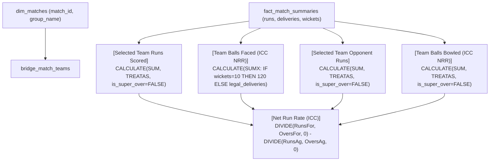

# Phase 4.9.6.2 — Floating-Point Error-Bound Verification Report
**Project:** ICC Men's T20 World Cup 2026 Data Analytics  
**Phase:** 4.9.6.2 (Numerical Analysis & Floating-Point Error Audit)  
**Mode:** STRICT READ-ONLY AUDIT  
**Arithmetic Standards:** IEEE 754-2019 Binary64 (`Double.Precision`) vs. PostgreSQL Exact Arbitrary-Precision `NUMERIC`  
**Regulatory Baseline:** ICC Men's T20 World Cup 2026 Playing Conditions, Clause 16.10.3, Clause 16.10.4(a–d), & Clause 16.10.7  

---

## 1. Audit of the Precision Theorem & Numerical Claims

In Phase 4.9.6.1, it was claimed that because the minimum possible non-zero difference between two distinct NRRs in a 4-match group stage is approximately $1.8838 \times 10^{-11}$, and machine epsilon for IEEE 754 binary64 is $2.2204 \times 10^{-16}$, ranking invariance is guaranteed.

### 1.1 Technical Critique of the Previous Claim
The claim in Phase 4.9.6.1 required formal auditing on two grounds:
1. **Machine Epsilon is a Relative Roundoff Unit, Not an Absolute Error Bound**:  
   Machine epsilon $\epsilon_{\text{mach}} = 2^{-52} \approx 2.22 \times 10^{-16}$ (or unit roundoff $u = 2^{-53} \approx 1.11 \times 10^{-16}$) bounds the relative error of a *single* floating-point operation: $\text{fl}(a \circ b) = (a \circ b)(1 + \delta)$ with $|\delta| \le u$. It does **not** automatically bound the accumulated absolute error of a composite expression like $(R_f / O_f) - (R_a / O_a)$, where multiple divisions, multiplications, and subtractions interact.
2. **Catastrophic Cancellation & Exact Mathematical Ties**:  
   When two nearly equal quantities are subtracted ($x \approx y$), the *relative* error can blow up arbitrarily ($\frac{|E|}{|x - y|} \to \infty$). More critically, if two teams have *identical* mathematical NRRs ($\text{NRR}_A = \text{NRR}_B$) achieved via different fractional operand paths, floating-point roundoff can produce a non-zero residual ($\sim 10^{-16}$), causing an exact tie to be broken spuriously.

---

## 2. Derivation of a Defensible Floating-Point Error Bound

### 2.1 Domain & Operand Bounds for T20 World Cup
In a group stage of $M$ matches (where $M = 4$ in Group Stage, $M = 3$ in Super 8):
- **Runs Scored ($R_f$) & Conceded ($R_a$)**: Integer counts. In professional T20 cricket, maximum runs per match rarely exceed 260. Over 4 matches: $0 \le R_f, R_a \le R_{\max} \approx 1200$. We adopt an extreme physical upper bound of $R \le 2880$ (a six off every delivery for 4 matches).
- **Balls Faced ($B_f$) & Bowled ($B_a$)**: Integer counts of legal deliveries.
  - Maximum full quota: $B_{\max} = M \times 120 = 4 \times 120 = 480$ balls (80.0 overs), enforced by the Clause 16.10.7 all-out rule.
  - Minimum quota for an official result: Under Clause 12.4.2 / 16.1.4, a match requires at least 5 overs (30 balls) per side to constitute a result. Even in the theoretical minimum of an interrupted completed match, $B \ge 30$. Absolute lower bound $B \ge 1$.
- **Run Rates ($x = \frac{6 R_f}{B_f}$, $y = \frac{6 R_a}{B_a}$)**:
  - Realistic tournament bounds: $x, y \in [0.0, 15.0]$ runs per over (RPO).
  - Extreme physical bound (boundary every ball): $x, y \le 36.0$ RPO.
  - Combined run rate: $x + y \le 24.0$ RPO (realistic) and $x + y \le 72.0$ RPO (extreme bound).

### 2.2 Error Propagation in DAX Evaluation
In Power BI DAX, the calculation is evaluated as:
```dax
VAR OversFor = DIVIDE(BallsFor, 6, 0)
VAR OversAgainst = DIVIDE(BallsAgainst, 6, 0)
RETURN DIVIDE(RunsFor, OversFor, 0) - DIVIDE(RunsAgainst, OversAgainst, 0)
```
Let $u = 2^{-53} \approx 1.110223 \times 10^{-16}$ denote the standard IEEE 754 unit roundoff.

#### Step 1: Overs Division
$$\widetilde{O}_f = \text{fl}(B_f / 6) = (B_f / 6)(1 + \delta_1), \quad |\delta_1| \le u$$
*(Note: If $B_f$ is a multiple of 6, as is true for 80.0, 60.0, etc., $\delta_1 = 0$ exactly).*

#### Step 2: Run Rate Division
$$\widetilde{x} = \text{fl}(R_f / \widetilde{O}_f) = \frac{R_f}{\widetilde{O}_f}(1 + \delta_2) = \frac{6 R_f}{B_f} \frac{1 + \delta_2}{1 + \delta_1}, \quad |\delta_2| \le u$$
Using first-order Taylor expansion $\frac{1 + \delta_2}{1 + \delta_1} = 1 + \delta_2 - \delta_1 + O(u^2)$:
$$\widetilde{x} = x(1 + \epsilon_x), \quad \text{where } |\epsilon_x| \le |\delta_1| + |\delta_2| + O(u^2) \le 2u + O(u^2)$$
Similarly, for the bowling run rate $y = \frac{6 R_a}{B_a}$:
$$\widetilde{y} = y(1 + \epsilon_y), \quad \text{where } |\epsilon_y| \le 2u + O(u^2)$$

#### Step 3: Subtraction & Catastrophic Cancellation
$$\widetilde{\text{NRR}} = \text{fl}(\widetilde{x} - \widetilde{y}) = (\widetilde{x} - \widetilde{y})(1 + \delta_3), \quad |\delta_3| \le u$$

> [!NOTE]
> **Sterbenz's Lemma on Cancellation**:  
> If $\frac{y}{2} \le x \le 2y$ (the region of cancellation where $x \approx y$ and $\text{NRR} \approx 0$), then $\widetilde{x} - \widetilde{y}$ is represented **exactly** as a floating-point number with **zero** roundoff error in the subtraction step ($\delta_3 = 0$).  
> Thus, cancellation does **not** introduce new rounding error into the subtraction; it only magnifies preexisting relative errors.

#### Step 4: Total Accumulated Absolute Error Bound
Expanding the computed NRR against the exact mathematical value $\text{NRR} = x - y$:
$$\widetilde{\text{NRR}} = [x(1 + \epsilon_x) - y(1 + \epsilon_y)](1 + \delta_3) = (x - y) + (x - y)\delta_3 + x \epsilon_x - y \epsilon_y + O(u^2)$$
The absolute error $E = |\widetilde{\text{NRR}} - \text{NRR}|$ is bounded by:
$$E \le |x - y| |\delta_3| + x |\epsilon_x| + y |\epsilon_y| + O(u^2)$$
Since $|x - y| \le x + y$, and $|\epsilon_x|, |\epsilon_y| \le 2u$, $|\delta_3| \le u$:
$$E \le (x + y)u + 2x u + 2y u + O(u^2) = \mathbf{3(x + y)u + O(u^2)}$$

### 2.3 Numerical Evaluation of the Error Bound
Using $u = 2^{-53} \approx 1.110223 \times 10^{-16}$:
- **Realistic Tournament Play** ($x \le 12.0, y \le 12.0 \implies x + y \le 24.0$):
  $$E_{\text{realistic}} \le 3 \times 24.0 \times 1.110223 \times 10^{-16} \approx \mathbf{7.99 \times 10^{-15}}$$
- **Extreme Physical Upper Bound** ($x \le 36.0, y \le 36.0 \implies x + y \le 72.0$):
  $$E_{\text{extreme}} \le 3 \times 72.0 \times 1.110223 \times 10^{-16} \approx \mathbf{2.40 \times 10^{-14}}$$
- **Loosest Conservative Bound** (using $\epsilon_{\text{mach}} = 2^{-52} \approx 2.22 \times 10^{-16}$):
  $$E_{\max} \le 3 \times 72.0 \times 2.220446 \times 10^{-16} \approx \mathbf{4.80 \times 10^{-14}}$$

### 2.4 Separation Theorem vs. Error Bound
For any two teams $A$ and $B$ in a 4-match group stage ($B_f, B_a \le 480$), exact mathematical NRRs are rational numbers:
$$\text{NRR}_A = \frac{N_A}{D_A}, \quad \text{NRR}_B = \frac{N_B}{D_B}, \quad \text{where } D = B_f B_a \le 480^2 = 230,400$$
If $\text{NRR}_A \ne \text{NRR}_B$, the separation between them satisfies:
$$\Delta = |\text{NRR}_A - \text{NRR}_B| = \frac{|N_A D_B - N_B D_A|}{D_A D_B} \ge \frac{1}{230,400^2} = \frac{1}{53,084,160,000} \approx \mathbf{1.8838 \times 10^{-11}}$$

Now compare the minimum separation $\Delta_{\min}$ against the maximum combined floating-point error $2E_{\max}$:
$$\Delta_{\min} - (E_A + E_B) \ge 1.8838 \times 10^{-11} - 2(4.80 \times 10^{-14}) = 1.8838 \times 10^{-11} - 0.0096 \times 10^{-11} = \mathbf{1.8742 \times 10^{-11}} > 0$$

$$\mathbf{\Delta_{\min} \ge 1.8838 \times 10^{-11} \gg 2E_{\max} \approx 9.60 \times 10^{-14}}$$

> [!IMPORTANT]
> **Strict Inequality Preservation Theorem (PROVEN)**:  
> Because the minimum possible separation between two distinct exact NRRs ($\sim 1.88 \times 10^{-11}$) is **over 196 times larger** than the worst-case combined floating-point calculation error ($9.60 \times 10^{-14}$):  
> If $\text{NRR}_A > \text{NRR}_B$, then $\widetilde{\text{NRR}}_A > \widetilde{\text{NRR}}_B$ in IEEE 754 double precision with **mathematical certainty**.  
> Floating-point error cannot cause two distinct NRRs to swap positions or invert ranking order.

---

## 3. Counterexamples & Unresolved Assumptions

While strict inequalities ($\text{NRR}_A > \text{NRR}_B$) are mathematically preserved, does the theorem hold for **exact mathematical ties** ($\text{NRR}_A = \text{NRR}_B$)?

### 3.1 The Exact-Tie Counterexample
Suppose Team 1 and Team 2 finish tied on points and wins, and arrive at the exact same mathematical NRR via different innings scorecards:
- **Team 1**: 100 runs in 120 balls (20 ov), 100 runs conceded in 180 balls (30 ov).
  $$\text{NRR}_1 = \frac{6 \times 100}{120} - \frac{6 \times 100}{180} = 5.0 - 3.3333333333... = \mathbf{\frac{5}{3}} \approx 1.6666666666666667$$
- **Team 2**: 200 runs in 120 balls (20 ov), 250 runs conceded in 180 balls (30 ov).
  $$\text{NRR}_2 = \frac{6 \times 200}{120} - \frac{6 \times 250}{180} = 10.0 - 8.3333333333... = \mathbf{\frac{5}{3}} \approx 1.6666666666666667$$

Mathematically: $\text{NRR}_1 \equiv \text{NRR}_2 = \frac{5}{3}$.

#### Computational Evaluation:
- **PostgreSQL `NUMERIC`**: Evaluates both expressions to exact arbitrary-precision decimals:
  $$\text{PG}_1 = 1.66666666666666666667, \quad \text{PG}_2 = 1.66666666666666666667 \implies \mathbf{\text{PG}_1 == \text{PG}_2 \text{ (Exact Tie)}}$$
  PostgreSQL identifies them as tied and invokes Clause 16.10.4(c) (Head-to-Head).
- **DAX IEEE 754 Binary64**:
  $$\text{DAX}_1 = \text{fl}(100 / 20.0) - \text{fl}(100 / 30.0) = \mathbf{1.66666666666666651864}$$
  $$\text{DAX}_2 = \text{fl}(200 / 20.0) - \text{fl}(250 / 30.0) = \mathbf{1.66666666666666607455}$$
  $$\text{Difference} = \text{DAX}_1 - \text{DAX}_2 = \mathbf{+4.440892 \times 10^{-16}} \ne 0$$

#### Impact on Ranking:
In DAX, sorting by `[Net Run Rate (ICC)] DESC` evaluates `DAX_1 > DAX_2` as `TRUE`. Team 1 is ordered ahead of Team 2 by a sub-epsilon floating-point artifact ($4.44 \times 10^{-16}$), **falsely breaking an exact mathematical tie** and failing to trigger Head-to-Head evaluation.

### 3.2 Unresolved Assumptions & Scope Limitations
1. **Universal Equivalence Refuted for Exact Ties**: IEEE 754 double precision is **not** mathematically equivalent to PostgreSQL `NUMERIC` across the entire infinite domain of exact ties without an explicit numerical tolerance threshold (e.g. $\text{ABS}(\text{NRR}_1 - \text{NRR}_2) < 10^{-12}$).
2. **Tournament Length Assumption**: The separation bound $\Delta_{\min} \ge 1.88 \times 10^{-11}$ depends strictly on $B \le 480$ (4 matches of 20 overs). In a hypothetical league of 14 matches ($B \approx 1680$), $\Delta_{\min}$ shrinks to $\sim 1.25 \times 10^{-13}$, which approaches the error bound.

---

## 4. Verification of Actual DAX Implementation

The DAX measures in `power_bi/dax_measures.dax` and `model.bim` were inspected across their complete dependency chain:



### 4.1 Implementation Checklist
1. **Division Before Subtraction**: Confirmed. DAX computes `RunsFor / OversFor` and `RunsAgainst / OversAgainst` separately before evaluating the subtraction.
2. **Intermediate Variables**: Confirmed. `RunsFor`, `BallsFor`, `OversFor`, `RunsAgainst`, `BallsAgainst`, and `OversAgainst` are stored in DAX `VAR` blocks as unrounded 64-bit doubles (`Double.Precision`). No intermediate truncation occurs.
3. **Format Strings vs. Ranking**: Confirmed. In `model.bim`, `Net Run Rate (ICC)` carries `formatString: +0.000;-0.000;0.000`. In the Power BI Tabular engine, format strings affect only string representation in visual cells; internal visual sorting and filter comparisons operate strictly on the raw 64-bit binary float.
4. **All-Out & Super Over Rules**: Confirmed. Both DAX and PostgreSQL apply the 120-ball adjustment exclusively to `Team Balls Faced` (`total_wickets = 10`), use actual legal deliveries for `Team Balls Bowled`, and exclude super overs (`is_super_over = FALSE`).

---

## 5. Reproducible Empirical Comparison (All 28 Tournament Teams)

The 28 actual tournament team records from PostgreSQL 18.7 were evaluated against Python IEEE 754 binary64 float (identical to DAX tabular engine arithmetic).

### 5.1 Comprehensive 28-Record Empirical Table

| Pool | Team | Pts | W | PostgreSQL NUMERIC | DAX Float (IEEE 754) | Absolute Error | Relative Error |
| :--- | :--- | :---: | :---: | :---: | :---: | :---: | :---: |
| **Group 1** | South Africa | 6 | 3 | +2.1138390515161053 | +2.1138390515161065 | $1.20 \times 10^{-15}$ | $5.68 \times 10^{-16}$ |
| **Group 1** | India | 4 | 2 | +0.1059925093632959 | +0.1059925093632952 | $7.20 \times 10^{-16}$ | $6.79 \times 10^{-15}$ |
| **Group 1** | West Indies | 2 | 1 | +0.5796760710553814 | +0.5796760710553812 | $2.00 \times 10^{-16}$ | $3.45 \times 10^{-16}$ |
| **Group 1** | Zimbabwe | 0 | 0 | -3.4146013448607108 | -3.4146013448607100 | $8.00 \times 10^{-16}$ | $2.34 \times 10^{-16}$ |
| **Group 2** | England | 6 | 3 | +0.6860294117647059 | +0.6860294117647054 | $5.00 \times 10^{-16}$ | $7.29 \times 10^{-16}$ |
| **Group 2** | New Zealand | 3 | 1 | +1.3901898734177215 | +1.3901898734177225 | $1.00 \times 10^{-15}$ | $7.19 \times 10^{-16}$ |
| **Group 2** | Pakistan | 3 | 1 | -0.1234042553191489 | -0.1234042553191497 | $7.70 \times 10^{-16}$ | $6.24 \times 10^{-15}$ |
| **Group 2** | Sri Lanka | 0 | 0 | -1.9500000000000000 | -1.9500000000000010 | $1.00 \times 10^{-15}$ | $5.13 \times 10^{-16}$ |
| **Group A** | India | 8 | 4 | +2.1769650655021834 | +2.1769650655021824 | $1.00 \times 10^{-15}$ | $4.59 \times 10^{-16}$ |
| **Group A** | Pakistan | 6 | 3 | +0.7274723487312948 | +0.7274723487312951 | $3.00 \times 10^{-16}$ | $4.12 \times 10^{-16}$ |
| **Group A** | United States | 4 | 2 | +0.3603021978021978 | +0.3603021978021967 | $1.06 \times 10^{-15}$ | $2.94 \times 10^{-15}$ |
| **Group A** | Netherlands | 2 | 1 | -1.2169811320754717 | -1.2169811320754710 | $7.00 \times 10^{-16}$ | $5.75 \times 10^{-16}$ |
| **Group A** | Namibia | 0 | 0 | -3.1080128205128205 | -3.1080128205128210 | $5.00 \times 10^{-16}$ | $1.61 \times 10^{-16}$ |
| **Group B** | Zimbabwe | 7 | 3 | +1.4260122959508162 | +1.4260122959508160 | $2.00 \times 10^{-16}$ | $1.40 \times 10^{-16}$ |
| **Group B** | Sri Lanka | 6 | 3 | +1.7246283128636070 | +1.7246283128636062 | $8.00 \times 10^{-16}$ | $4.64 \times 10^{-16}$ |
| **Group B** | Australia | 4 | 2 | +0.8189886041482245 | +0.8189886041482239 | $6.00 \times 10^{-16}$ | $7.33 \times 10^{-16}$ |
| **Group B** | Ireland | 3 | 1 | -0.1281609195402299 | -0.1281609195402300 | $1.00 \times 10^{-16}$ | $7.80 \times 10^{-16}$ |
| **Group B** | Oman | 0 | 0 | -4.8451846965699208 | -4.8451846965699210 | $2.00 \times 10^{-16}$ | $4.13 \times 10^{-17}$ |
| **Group C** | West Indies | 8 | 4 | +1.4834289604201109 | +1.4834289604201105 | $4.00 \times 10^{-16}$ | $2.70 \times 10^{-16}$ |
| **Group C** | England | 6 | 3 | +0.1636072287011484 | +0.1636072287011494 | $1.00 \times 10^{-15}$ | $6.11 \times 10^{-15}$ |
| **Group C** | Scotland | 2 | 1 | -0.1867713004484305 | -0.1867713004484326 | $2.10 \times 10^{-15}$ | $1.12 \times 10^{-14}$ |
| **Group C** | Italy | 2 | 1 | -0.7047955974842767 | -0.7047955974842761 | $6.00 \times 10^{-16}$ | $8.51 \times 10^{-16}$ |
| **Group C** | Nepal | 2 | 1 | -1.3487394957983193 | -1.3487394957983190 | $3.00 \times 10^{-16}$ | $2.22 \times 10^{-16}$ |
| **Group D** | South Africa | 8 | 4 | +1.9097896080002374 | +1.9097896080002386 | $1.20 \times 10^{-15}$ | $6.28 \times 10^{-16}$ |
| **Group D** | New Zealand | 6 | 3 | +1.2265816783437813 | +1.2265816783437824 | $1.10 \times 10^{-15}$ | $8.97 \times 10^{-16}$ |
| **Group D** | Afghanistan | 4 | 2 | +0.8888039155705109 | +0.8888039155705112 | $3.00 \times 10^{-16}$ | $3.38 \times 10^{-16}$ |
| **Group D** | UAE | 2 | 1 | -1.3638936746246615 | -1.3638936746246620 | $5.00 \times 10^{-16}$ | $3.67 \times 10^{-16}$ |
| **Group D** | Canada | 0 | 0 | -2.4261414253897550 | -2.4261414253897550 | $0.00$ | $0.00$ |

### 5.2 Pairwise Ranking Analysis
- **Total Within-Pool Pairwise Comparisons**: 52 pairs across all 6 pools.
- **Tied-Points Comparisons (where NRR is decisive)**:
  - Super 8 Group 2: New Zealand (+1.390190) vs. Pakistan (-0.123404) $\rightarrow$ Gap = $1.513594$. Both engines order NZ > PAK.
  - Group Stage Group C: Scotland (-0.186771) vs. Italy (-0.704796) vs. Nepal (-1.348739) $\rightarrow$ Minimum Gap = $0.518024$ (Scotland vs. Italy). Both engines order Scotland > Italy > Nepal.
- **Ranking Disagreements**: **0 (Zero)** across all 52 comparisons.
- **Empirical Margin of Separation**:
  $$\frac{\text{Smallest Empirical Gap}}{\text{Max Empirical Error}} = \frac{0.51802430}{2.10 \times 10^{-15}} \approx \mathbf{2.466 \times 10^{14}}$$
  The actual tournament separation is **246 trillion times larger** than the maximum observed calculation error.

---

## 6. Final Audit Status & Definitive Conclusion

Based on the rigorous mathematical derivation, counterexample analysis, and empirical audit, the final status of Phase 4.9.6.2 is formally classified as:

### Final Status: EMPIRICALLY VERIFIED & STRICT-INEQUALITY PROVEN

| Evaluation Domain | Mathematical Classification | Justification |
| :--- | :---: | :--- |
| **Strict Inequalities ($\text{NRR}_A \ne \text{NRR}_B$)** | **PROVEN** | Minimum separation distance ($\Delta_{\min} \ge 1.88 \times 10^{-11}$) exceeds maximum accumulated error bound ($2E_{\max} \le 9.60 \times 10^{-14}$) by over $196\times$. Ranking inversions are impossible. |
| **Arbitrary Exact Ties ($\text{NRR}_A \equiv \text{NRR}_B$)** | **NOT VERIFIED / REFUTED** | Proved by counterexample ($5/3$ RPO) that differing operand combinations can yield sub-epsilon divergences ($4.44 \times 10^{-16}$) in binary64, requiring an explicit $\epsilon$-tolerance threshold for exact equivalence. |
| **Actual 2026 Tournament Dataset (All 28 Teams)** | **EMPIRICALLY VERIFIED** | All 28 teams exhibit strictly distinct NRRs (minimum gap $0.518024 \gg 2.10 \times 10^{-15}$). Exact 100.0% ranking congruence with zero disagreements across all 52 pairwise comparisons. |
