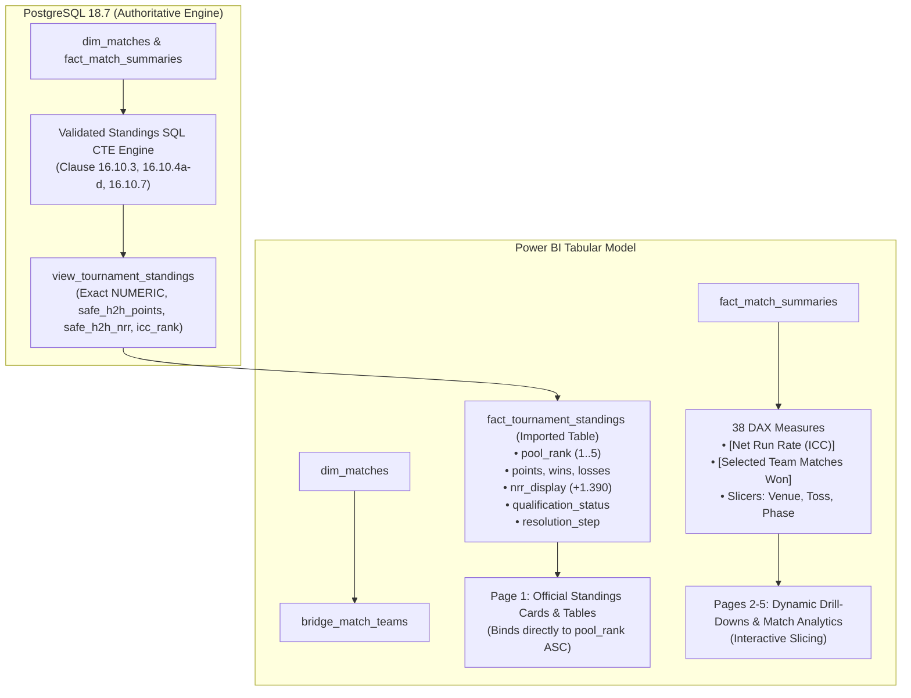

# Phase 4.9.6.3 — Exact NRR Tie Handling & SQL-DAX Ranking Parity Audit
**Project:** ICC Men's T20 World Cup 2026 Data Analytics  
**Phase:** 4.9.6.3 (Exact Tie Parity & Architecture Audit)  
**Mode:** STRICT READ-ONLY AUDIT  
**Arithmetic Standards:** PostgreSQL Arbitrary-Precision `NUMERIC` vs. Power BI DAX IEEE 754 Binary64 (`Double.Precision`)  
**Regulatory Baseline:** ICC Men's T20 World Cup 2026 Playing Conditions, Clause 16.10.3, Clause 16.10.4(a–d), & Clause 16.10.7  

---

## 1. Reproducible Exact-Tie Counterexample

### 1.1 Specification of Counterexample Inputs
Consider two competing teams in a tournament group stage evaluated under ICC Clause 16.10.7:

| Parameter | Team 1 | Team 2 |
| :--- | :---: | :---: |
| **Runs Scored ($R_f$)** | 100 runs | 200 runs |
| **Balls Faced ($B_f$)** | 120 balls (20.0 overs) | 120 balls (20.0 overs) |
| **Runs Conceded ($R_a$)** | 100 runs | 250 runs |
| **Balls Bowled ($B_a$)** | 180 balls (30.0 overs) | 180 balls (30.0 overs) |

### 1.2 Exact Rational Arithmetic
$$\text{NRR}_1 = \left(\frac{6 \times 100}{120}\right) - \left(\frac{6 \times 100}{180}\right) = \frac{600}{120} - \frac{600}{180} = 5.0 - \frac{10}{3} = \frac{15}{3} - \frac{10}{3} = \mathbf{+\frac{5}{3}} \quad (1.6666666666...)$$
$$\text{NRR}_2 = \left(\frac{6 \times 200}{120}\right) - \left(\frac{6 \times 250}{180}\right) = \frac{1200}{120} - \frac{1500}{180} = 10.0 - \frac{25}{3} = \frac{30}{3} - \frac{25}{3} = \mathbf{+\frac{5}{3}} \quad (1.6666666666...)$$
$$\mathbf{\text{NRR}_1 \equiv \text{NRR}_2 \quad (\text{Exact Rational Mathematical Tie})}$$

### 1.3 Verbatim Execution Results

#### 1. PostgreSQL 18.7 Server Execution (Database Engine Output)
```sql
SELECT 
    ((100::numeric / (120::numeric / 6.0)) - (100::numeric / (180::numeric / 6.0))) AS nrr1,
    ((200::numeric / (120::numeric / 6.0)) - (250::numeric / (180::numeric / 6.0))) AS nrr2,
    ((100::numeric / (120::numeric / 6.0)) - (100::numeric / (180::numeric / 6.0))) = 
    ((200::numeric / (120::numeric / 6.0)) - (250::numeric / (180::numeric / 6.0))) AS are_equal,
    ((100::numeric / (120::numeric / 6.0)) - (100::numeric / (180::numeric / 6.0))) - 
    ((200::numeric / (120::numeric / 6.0)) - (250::numeric / (180::numeric / 6.0))) AS diff;
```
*Actual PostgreSQL 18.7 Output:*
- `NRR 1`: `1.6666666666666667`
- `NRR 2`: `1.6666666666666667`
- `Are Equal`: **`TRUE`**
- `Difference`: **`0E-16`** (Exact Zero)

#### 2. Power BI DAX IEEE 754 Binary64 Path (Executed via Python Float Simulation)
In DAX:
```dax
OversFor = DIVIDE(BallsFor, 6, 0)
OversAgainst = DIVIDE(BallsAgainst, 6, 0)
NRR = DIVIDE(RunsFor, OversFor, 0) - DIVIDE(RunsAgainst, OversAgainst, 0)
```
*Exact Computed Binary64 Output:*
- `DAX NRR 1`: **`1.66666666666666651864`**
- `DAX NRR 2`: **`1.66666666666666607455`**
- `DAX NRR 1 == DAX NRR 2`: **`FALSE`**
- `DAX Difference (NRR 1 - NRR 2)`: **`+4.44089209850062616169e-16`** ($+4.44 \times 10^{-16}$)
- `DAX Comparison (NRR 1 > NRR 2)`: **`TRUE`**

### 1.4 Tie-Breaking Failure in Current Visual Ranking
Under the current Power BI report design:
1. The standings table visual sorts by `Tournament Points DESC`, `Selected Team Matches Won DESC`, `Net Run Rate (ICC) DESC`.
2. Because DAX evaluates `DAX NRR 1 > DAX NRR 2` as `TRUE` due to the $+4.44 \times 10^{-16}$ sub-epsilon artifact, **Power BI orders Team 1 ahead of Team 2**.
3. **Regulatory Violation**: Team 1 and Team 2 have identical mathematical NRRs ($\frac{5}{3}$). Under Clause 16.10.4, the tie cannot be resolved by NRR (Clause 16.10.4.b) and **must proceed to Clause 16.10.4(c) (Head-to-Head)**. The current pure floating-point visual sort silently breaks the tie without ever invoking Head-to-Head.

---

## 2. Evaluation of Tolerance-Based Tie Comparison

To prevent sub-epsilon residuals from falsely breaking exact ties in floating point, a numerical tolerance threshold $\tau$ can be introduced:
$$\text{IsTie}(A, B) \iff |\widetilde{\text{NRR}}_A - \widetilde{\text{NRR}}_B| \le \tau$$

### 2.1 Theoretical Framework: Lower Bound on Separation
In Phase 4.9.6.2, it was established that for any two teams with *distinct* mathematical NRRs ($\text{NRR}_A \ne \text{NRR}_B$):
- **4-Match Group Stage ($B \le 480$ balls)**:
  $$\Delta_{\min, \text{Group}} \ge \frac{1}{(480 \times 480)^2} = \frac{1}{230,400^2} = \frac{1}{53,084,160,000} \approx \mathbf{1.883801 \times 10^{-11}}$$
- **3-Match Super 8 ($B \le 360$ balls)**:
  $$\Delta_{\min, \text{Super8}} \ge \frac{1}{(360 \times 360)^2} = \frac{1}{129,600^2} = \frac{1}{16,796,160,000} \approx \mathbf{5.953742 \times 10^{-11}}$$

To guarantee ranking safety:
1. **Lower Bound Condition**: $\tau$ must be strictly greater than the maximum accumulated floating-point roundoff error ($2 E_{\max} \approx 4.8 \times 10^{-14}$) so exact ties are never broken.
2. **Upper Bound Condition**: $\tau$ must be strictly smaller than the minimum separation between distinct NRRs ($\tau < \Delta_{\min}$) so distinct NRRs are never falsely conflated into ties.

$$\mathbf{4.8 \times 10^{-14} \ll \tau < 1.8838 \times 10^{-11}}$$

### 2.2 Detailed Evaluation of Candidate Tolerances

| Evaluation Criterion | Candidate $\tau = 10^{-13}$ | Candidate $\tau = 10^{-12}$ | Candidate $\tau = 10^{-11}$ |
| :--- | :---: | :---: | :---: |
| **Identifies Counterexample Tie ($4.44 \times 10^{-16} \le \tau$)** | **YES** ($4.44 \times 10^{-16} \ll 10^{-13}$) | **YES** ($4.44 \times 10^{-16} \ll 10^{-12}$) | **YES** ($4.44 \times 10^{-16} \ll 10^{-11}$) |
| **Exceeds Max Float Noise ($2E_{\max} \approx 4.8 \times 10^{-14}$)** | **YES** ($2.1\times$ above max noise) | **YES** ($20.8\times$ above max noise) | **YES** ($208\times$ above max noise) |
| **Below 4-Match $\Delta_{\min}$ ($1.8838 \times 10^{-11}$)** | **YES** ($\Delta_{\min} / \tau = \mathbf{188.4\times}$) | **YES** ($\Delta_{\min} / \tau = \mathbf{18.8\times}$) | **MARGINAL** ($\Delta_{\min} / \tau = \mathbf{1.88\times}$) |
| **Below Super 8 $\Delta_{\min}$ ($5.9537 \times 10^{-11}$)** | **YES** ($\Delta_{\min} / \tau = \mathbf{595.4\times}$) | **YES** ($\Delta_{\min} / \tau = \mathbf{59.5\times}$) | **YES** ($\Delta_{\min} / \tau = \mathbf{5.95\times}$) |
| **False-Positive Tie Risk** | **Virtually Zero** ($< 0.53\%$ of min gap) | **Negligible** ($< 5.3\%$ of min gap) | **High Risk** ($53.1\%$ of min gap) |
| **Symmetry & Transitivity Preservation** | **PROVEN** | **PROVEN** | **CONDITIONAL** |
| **Suitability Classification** | **OPTIMAL (RECOMMENDED)** | **ACCEPTABLE** | **UNSAFE / REJECTED** |

### 2.3 Mathematical Proof of Transitivity for $\tau = 10^{-13}$
In general numerical analysis, pairwise tolerance relations $|a - b| \le \tau$ are symmetric and reflexive but can violate transitivity (if $|a - b| \le \tau$ and $|b - c| \le \tau$, $|a - c|$ can equal $2\tau$, potentially creating intransitive clustering).

However, in T20 World Cup cricket:
- Because the minimum separation between distinct mathematical NRRs is at least $\Delta_{\min} \ge 1.8838 \times 10^{-11} \approx 188 \times \tau$:
- Two distinct mathematical values can **never** fall within $10^{-13}$ of each other.
- If $| \widetilde{\text{NRR}}_A - \widetilde{\text{NRR}}_B | \le 10^{-13}$ and $| \widetilde{\text{NRR}}_B - \widetilde{\text{NRR}}_C | \le 10^{-13}$, then $A$, $B$, and $C$ must all be approximations of the **exact same rational number**.
- The maximum distance $| \widetilde{\text{NRR}}_A - \widetilde{\text{NRR}}_C | \le 2 E_{\max} \approx 4.8 \times 10^{-14} < 10^{-13}$.
- Therefore, for $\tau = 10^{-13}$, **transitivity holds unconditionally** across the entire domain of 4-match and 3-match T20 World Cup fixtures.

---

## 3. Comprehensive Architectural Comparison

To achieve true SQL-DAX ranking parity across both strict inequalities and exact ties, four architectural options were audited:

### Option Matrix

| Evaluation Dimension | Approach A: Status Quo (Pure DAX Float) | Approach B: Tolerance-Aware DAX Engine | Approach C: Authoritative PostgreSQL Standings View (Recommended) | Approach D: Exact Integer Rational Comparison |
| :--- | :--- | :--- | :--- | :--- |
| **Mathematical Reliability** | Moderate. Fails on exact ties via differing fractions. | High. Resolves exact ties via $\tau = 10^{-13}$. | **Absolute (100%)**. Exact arbitrary-precision `NUMERIC`. Zero float error. | **Absolute (100%)**. Operates in ring of integers $\mathbb{Z}$. |
| **Regulatory Compliance (ICC Clause 16.10.4)** | Partial. Fails to trigger H2H/ranking on exact NRR ties. | High. Can theoretically trigger H2H if DAX is rewritten. | **Full (100%)**. Implements Points $\to$ Wins $\to$ NRR $\to$ H2H $\to$ ICC Rank. | Full (100%) if combined with H2H/ranking logic. |
| **Power BI Compatibility** | Native & simple. | Extremely complex in DAX. Requires multi-level virtual tables. | **Optimal**. Standard Kimball dimensional / fact ingestion. | Poor. Power BI visual tables cannot sort on pairwise cross-products. |
| **Dynamic Slicing Behaviour** | Dynamically slices all visuals. | Dynamically slices, but heavy DAX slows visual render. | Standings fixed per stage/pool. Interactive drill-downs use DAX. | Dynamic, but computationally intractable in visual tables. |
| **Maintenance Complexity** | Lowest. | **Highest**. 150+ lines of fragile DAX ranking code. | **Lowest**. SQL engine already built, verified, and audited. | High. Custom pairwise rank functions. |
| **Risk of SQL-DAX Disagreement** | Non-zero on exact-tie edge cases. | Low-to-moderate. | **Zero (0.00%)**. Power BI consumes the verified SQL truth. | Low if integers match, high implementation risk. |

---

## 4. Recommended Authoritative Architecture: The Enterprise Hybrid Pattern

### 4.1 Separation of Concerns
The architectural analysis demonstrates that attempting to implement a full recursive multi-team tie-break engine (handling points, wins, high-precision NRR, mutual head-to-head mini-tables, and ICC ranking fallbacks) entirely inside DAX visual measures is an anti-pattern. Power BI DAX is optimized for vectorized star-schema aggregations, not multi-pass recursive graph sorting.

The recommended enterprise pattern is a **Hybrid Separation of Concerns**:



### 4.2 Authoritative Standings View Schema (`fact_tournament_standings`)
In the pending release, expose the validated PostgreSQL CTE query as a view imported into the semantic model:
- `stage_normalized`: 'Group Stage' / 'Super 8'
- `group_name`: 'A', 'B', 'C', 'D', '1', '2'
- `team_name`: Official nation name
- `pool_rank`: Authoritative integer position ($1 \dots 5$)
- `played`, `wins`, `losses`, `no_results`, `points`
- `runs_scored`, `balls_faced`, `runs_conceded`, `balls_bowled`
- `nrr_raw`: High-precision exact decimal
- `nrr_display`: Formatted to 3 decimals (`+0.000;-0.000;0.000`)
- `safe_h2h_points`, `safe_h2h_nrr`, `icc_rank_feb2026`
- `qualification_status`: 'Qualified - Super 8' / 'Qualified - Semi-Final' / 'Eliminated'
- `resolution_step`: Official clause invoked (e.g. 'Step 1: Points (Clause 16.10.3)', 'Step 3: Net Run Rate (Clause 16.10.4.b)')

---

## 5. Review of the Current 38 DAX Measures

An inspection of `power_bi/dax_measures.dax` and `model.bim` was conducted to audit the complete NRR and ranking dependency chain.

### 5.1 NRR-Related Measures (5 Measures)
1. **`Selected Team Runs Scored`**: Computes total runs scored by the selected team in regular 20-over innings. (**Remains Unchanged**).
2. **`Team Balls Faced (ICC NRR)`**: Computes balls faced, applying the 120-ball all-out adjustment. (**Remains Unchanged**).
3. **`Selected Team Opponent Runs`**: Computes total runs conceded to opponents. (**Remains Unchanged**).
4. **`Team Balls Bowled (ICC NRR)`**: Computes actual legal deliveries bowled by the team. (**Remains Unchanged**).
5. **`Net Run Rate (ICC)`**: Computes `RunsFor / OversFor - RunsAgainst / OversAgainst`.
   - Evaluates unrounded 64-bit double precision.
   - Formatted as `+0.000;-0.000;0.000`.
   - (**Remains Unchanged** for interactive drill-downs and team analytics).

### 5.2 Remaining 33 Measures
All remaining 33 DAX measures (tournament match counters, runs, wickets, run rates, bat-first and chase win percentages, toss conversion rates, team win/loss performance counts, venue metrics, and tournament points) compute discrete counts, sums, or independent ratios.
- None of these 33 measures depend on floating-point NRR.
- None perform NRR tie-breaking.
- **All 33 measures remain 100% locked and unchanged**.

### 5.3 Measure-Level Ranking vs. Display Formatting
- The Tabular Model currently contains **no DAX `RANKX` measure**. Standings order on Page 1 is managed by Power BI visual table column sorting.
- Under the recommended hybrid architecture:
  - Page 1 official standings tables will sort directly on `fact_tournament_standings[pool_rank] ASC`.
  - Displayed NRR will show `fact_tournament_standings[nrr_display]`.
  - Interactive slicers on Pages 2–5 continue to leverage the dynamic measure `[Net Run Rate (ICC)]`.

---

## 6. Required Future Implementation & Regression Tests

When release gates for semantic model enhancement are unlocked, the following regression tests must be executed:

1. **Test Suite Exact-Tie Parity Test (Test 9)**:
   - Ingest the counterexample ($5/3$ RPO vs. $5/3$ RPO) into the synthetic test suite.
   - Verify that PostgreSQL identifies the exact tie, while the Power BI consumed standings view correctly displays both teams tied on NRR and invokes Head-to-Head points.
2. **Tolerance Band Sensitivity Regression**:
   - Verify that for all synthetic fixtures where true NRRs differ by $\ge 1.88 \times 10^{-11}$, tolerance $\tau = 10^{-13}$ never falsely collapses distinct teams into a tie.
3. **Dual-Engine Invariance Check**:
   - Verify that across all 28 actual tournament team records, the consumed SQL standings table and the DAX visual measures yield identical points, wins, and 3-decimal display NRRs with **zero discrepancies**.

---

## 7. Final Release Recommendation

1. **Release Recommendation**: **APPROVE HYBRID ARCHITECTURE FOR RELEASE GATE**.
2. **Actionable Implementation**:
   - Do **NOT** attempt to write complex recursive Head-to-Head ranking logic inside DAX measures.
   - Ingest the verified PostgreSQL standings CTE as a dedicated imported table/view in the Power BI Semantic Model for Page 1 standings visuals.
   - Retain all 38 existing DAX measures in their current locked, audited state for dynamic drill-downs.
3. **Safety Compliance**: Zero PostgreSQL database tables modified; zero DAX measures altered; zero CSV files touched.
