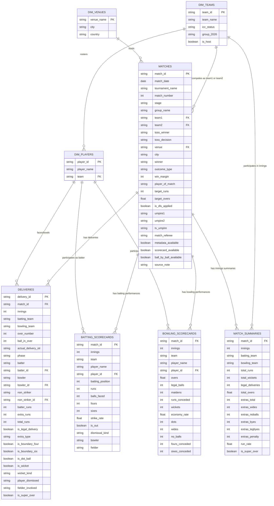

# Data Dictionary: ICC Men's T20 World Cup 2026 Data Analytics

This document defines the schema, data types, constraints, descriptions, and relational keys for all normalized datasets generated in the analytics pipeline.

---

## 1. Entity-Relationship Overview

---

## 2. Table Specifications

### A. `dim_teams` (Team Dimension - 20 Teams)
Stores all 20 participating national teams in the 2026 ICC Men's T20 World Cup.

| Column | Type | Nullable | Key | Description |
| :--- | :--- | :---: | :---: | :--- |
| `team_id` | VARCHAR(10) | No | PK | Three-letter team identifier (e.g., `"AFG"`, `"IND"`, `"AUS"`). |
| `team_name` | VARCHAR(50) | No | Unique | Full official name of the national cricket team. |
| `icc_status` | VARCHAR(30) | No | | ICC Membership tier (`"Full Member"` or `"Associate Member"`). |
| `group_2026` | VARCHAR(20) | No | | Initial group allocation in the 2026 World Cup (`"Group A"`, `"Group B"`, `"Group C"`, `"Group D"`). |
| `is_host` | BOOLEAN | No | | True for co-hosts India and Sri Lanka; False otherwise. |

---

### B. `matches` (Match Dimension - 55 Matches)
Stores match parameters, venues, officials, results, and data provenance flags for all 55 scheduled fixtures.

| Column | Type | Nullable | Key | Description |
| :--- | :--- | :---: | :---: | :--- |
| `match_id` | VARCHAR(32) | No | PK | Unique match identifier (Cricsheet ID or ICC official match ID). |
| `match_date` | DATE | No | | Scheduled match date (`YYYY-MM-DD`). |
| `tournament_name` | VARCHAR(100) | No | | Tournament label (`"ICC Men's T20 World Cup"`). |
| `match_number` | INTEGER | Yes | | Official scheduled sequence number (1 through 55). |
| `stage` | VARCHAR(50) | Yes | | Phase (`"Group"`, `"Super 8"`, `"Semi Final"`, `"Final"`). |
| `group_name` | VARCHAR(20) | Yes | | Group assignment (`"A"`, `"B"`, `"C"`, `"D"`, `"1"`, `"2"`). |
| `team1` | VARCHAR(50) | No | FK | First team. |
| `team2` | VARCHAR(50) | No | FK | Second team. |
| `toss_winner` | VARCHAR(50) | Yes | | Team winning toss. Null if match abandoned without toss. |
| `toss_decision` | VARCHAR(10) | Yes | | Toss decision (`"bat"` or `"field"`). Null if abandoned. |
| `venue` | VARCHAR(100) | No | FK | Stadium name where match occurred. |
| `city` | VARCHAR(50) | Yes | | Host city. |
| `winner` | VARCHAR(50) | No | | Winning team or `"Result: No Result"`. |
| `outcome_type` | VARCHAR(30) | No | | Margin category (`"runs"`, `"wickets"`, `"tie_super_over"`, `"no result"`). |
| `win_margin` | INTEGER | No | | Victory margin. 0 for ties or no-result. |
| `player_of_match` | VARCHAR(100) | Yes | | Player of the Match awardee. |
| `target_runs` | INTEGER | Yes | | 2nd innings target runs. |
| `target_overs` | NUMERIC(4,1) | Yes | | 2nd innings target overs. |
| `is_dls_applied` | BOOLEAN | No | | True if DLS method applied; False otherwise. |
| `umpire1` | VARCHAR(100) | Yes | | First on-field umpire. |
| `umpire2` | VARCHAR(100) | Yes | | Second on-field umpire. |
| `tv_umpire` | VARCHAR(100) | Yes | | Third / Television umpire. |
| `match_referee` | VARCHAR(100) | Yes | | ICC Match Referee. |
| `metadata_available` | BOOLEAN | No | | True if match date, teams, venue, and outcome are verified (55/55). |
| `scorecard_available` | BOOLEAN | No | | True if innings/scorecard summary exists (53/55; 2 rain abandonments). |
| `ball_by_ball_available` | BOOLEAN | No | | True if Cricsheet delivery sequences are available (49/55). |
| `source_note` | VARCHAR(255) | No | | Data provenance attribution note. |

---

### C. `deliveries` (Fact Deliveries - 11,555 Records)
Granular ball-by-ball telemetry for all 49 matches with authorized public delivery feeds.

| Column | Type | Nullable | Key | Description |
| :--- | :--- | :---: | :---: | :--- |
| `delivery_id` | VARCHAR(64) | No | PK | Surrogate key: `{match_id}_{innings}_{over}_{ball}`. |
| `match_id` | VARCHAR(32) | No | FK | Parent match ID. |
| `innings` | INTEGER | No | | Innings sequence (1 or 2, >2 for super overs). |
| `batting_team` | VARCHAR(50) | No | | Team batting. |
| `bowling_team` | VARCHAR(50) | No | | Team bowling and fielding. |
| `over_number` | INTEGER | No | | Over number (0 to 19). |
| `ball_in_over` | INTEGER | No | | Ball index in over (1, 2, ...). |
| `actual_delivery_str` | VARCHAR(10) | No | | Ball notation (`"0.1"`, `"19.6"`). |
| `phase` | VARCHAR(20) | No | | Game phase: `"Powerplay"` (0-5), `"Middle"` (6-14), `"Death"` (15-19). |
| `batter` | VARCHAR(100) | No | | Striker facing ball. |
| `batter_id` | VARCHAR(32) | No | FK | Batter registry ID. |
| `bowler` | VARCHAR(100) | No | | Bowler. |
| `bowler_id` | VARCHAR(32) | No | FK | Bowler registry ID. |
| `non_striker` | VARCHAR(100) | No | | Non-striker. |
| `non_striker_id` | VARCHAR(32) | No | FK | Non-striker registry ID. |
| `batter_runs` | INTEGER | No | | Runs scored off bat. |
| `extra_runs` | INTEGER | No | | Extra runs conceded. |
| `total_runs` | INTEGER | No | | Total runs (`batter_runs + extra_runs`). |
| `is_legal_delivery` | BOOLEAN | No | | False if wide or no-ball; True otherwise. |
| `extra_type` | VARCHAR(50) | Yes | | Sub-type of extra (`"wides"`, `"noballs"`, `"byes"`, `"legbyes"`). |
| `is_boundary_four` | BOOLEAN | No | | True if batter hit a 4. |
| `is_boundary_six` | BOOLEAN | No | | True if batter hit a 6. |
| `is_dot_ball` | BOOLEAN | No | | True if legal delivery with 0 runs conceded. |
| `is_wicket` | BOOLEAN | No | | True if a dismissal occurred. |
| `wicket_kind` | VARCHAR(50) | Yes | | Mode of dismissal (`"caught"`, `"bowled"`, `"lbw"`, `"run out"`, etc.). |
| `player_dismissed` | VARCHAR(100) | Yes | | Name of dismissed batter. |
| `fielder_involved` | VARCHAR(100) | Yes | | Fielder(s) involved in dismissal. |
| `is_super_over` | BOOLEAN | No | | True if tiebreaker super over. |

---

### D. `batting_scorecards` (Fact Batting Performance)
Batting summaries per player per innings.

| Column | Type | Nullable | Key | Description |
| :--- | :--- | :---: | :---: | :--- |
| `match_id` | VARCHAR(32) | No | FK | Parent match ID. |
| `innings` | INTEGER | No | | Innings index. |
| `team` | VARCHAR(50) | No | | Batting team. |
| `player_name` | VARCHAR(100) | No | | Batsman name. |
| `player_id` | VARCHAR(32) | No | FK | Player ID. |
| `batting_position` | INTEGER | No | | Crease entry sequence position. |
| `runs` | INTEGER | No | | Runs off bat. |
| `balls_faced` | INTEGER | No | | Deliveries faced (excluding wides). |
| `fours` | INTEGER | No | | Count of 4s hit. |
| `sixes` | INTEGER | No | | Count of 6s hit. |
| `strike_rate` | NUMERIC(6,2) | No | | Strike rate (`(runs / balls_faced) * 100`). |
| `is_out` | BOOLEAN | No | | True if dismissed; False if not out. |
| `dismissal_kind` | VARCHAR(50) | No | | Dismissal mode or `"not out"`. |
| `bowler` | VARCHAR(100) | Yes | | Dismissing bowler. |
| `fielder` | VARCHAR(100) | Yes | | Dismissal fielder. |

---

### E. `bowling_scorecards` (Fact Bowling Performance)
Bowling summaries per player per innings.

| Column | Type | Nullable | Key | Description |
| :--- | :--- | :---: | :---: | :--- |
| `match_id` | VARCHAR(32) | No | FK | Parent match ID. |
| `innings` | INTEGER | No | | Innings index. |
| `team` | VARCHAR(50) | No | | Bowling team. |
| `player_name` | VARCHAR(100) | No | | Bowler name. |
| `player_id` | VARCHAR(32) | No | FK | Bowler player ID. |
| `overs` | NUMERIC(4,1) | No | | Overs bowled (e.g. `4.0`, `3.2`). |
| `legal_balls` | INTEGER | No | | Legal deliveries. |
| `maidens` | INTEGER | No | | 6-ball maiden overs (0 runs conceded). |
| `runs_conceded` | INTEGER | No | | Charged runs (`batter_runs + wides + noballs`). |
| `wickets` | INTEGER | No | | Bowler-credited dismissals. |
| `economy_rate` | NUMERIC(5,2) | No | | Economy rate (`runs / (legal_balls / 6)`). |
| `dots` | INTEGER | No | | Dot balls bowled. |
| `wides` | INTEGER | No | | Wides conceded. |
| `no_balls` | INTEGER | No | | No-balls conceded. |
| `fours_conceded` | INTEGER | No | | 4s conceded. |
| `sixes_conceded` | INTEGER | No | | 6s conceded. |

---

### F. `match_summaries` (Innings Summary Fact - 106 Innings)
Team-level totals per innings across all 53 played matches.

| Column | Type | Nullable | Key | Description |
| :--- | :--- | :---: | :---: | :--- |
| `match_id` | VARCHAR(32) | No | FK | Parent match ID. |
| `innings` | INTEGER | No | | Innings sequence (1 or 2). |
| `batting_team` | VARCHAR(50) | No | | Batting side. |
| `bowling_team` | VARCHAR(50) | No | | Bowling side. |
| `total_runs` | INTEGER | No | | Final innings score. |
| `total_wickets` | INTEGER | No | | Wickets lost in innings. |
| `legal_deliveries` | INTEGER | No | | Legal balls bowled. |
| `total_overs` | NUMERIC(4,1) | No | | Overs completed in innings. |
| `extras_total` | INTEGER | No | | Total extra runs conceded. |
| `extras_wides` | INTEGER | No | | Wides. |
| `extras_noballs` | INTEGER | No | | No-balls. |
| `extras_byes` | INTEGER | No | | Byes. |
| `extras_legbyes` | INTEGER | No | | Leg-byes. |
| `extras_penalty` | INTEGER | No | | Penalty extras. |
| `run_rate` | NUMERIC(5,2) | No | | Innings run rate (`total_runs / (legal_deliveries / 6)`). |
| `is_super_over` | BOOLEAN | No | | True if super over innings. |

---

### G. `dim_players` (Player Dimension - 282 Players)
Master registry of all participating players across all 20 tournament nations.

| Column | Type | Nullable | Key | Description |
| :--- | :--- | :---: | :---: | :--- |
| `player_id` | VARCHAR(32) | No | PK | Unique registry identifier or normalized name. |
| `player_name` | VARCHAR(100) | No | | Full player name. |
| `team` | VARCHAR(50) | No | FK | National team represented. |

---

### H. `dim_venues` (Venue Dimension - 8 Stadiums)
Master stadium catalog with country assignment.

| Column | Type | Nullable | Key | Description |
| :--- | :--- | :---: | :---: | :--- |
| `venue_name` | VARCHAR(100) | No | PK | Stadium name. |
| `city` | VARCHAR(50) | Yes | | Host city. |
| `country` | VARCHAR(50) | No | | Host nation (`"India"` or `"Sri Lanka"`). |
