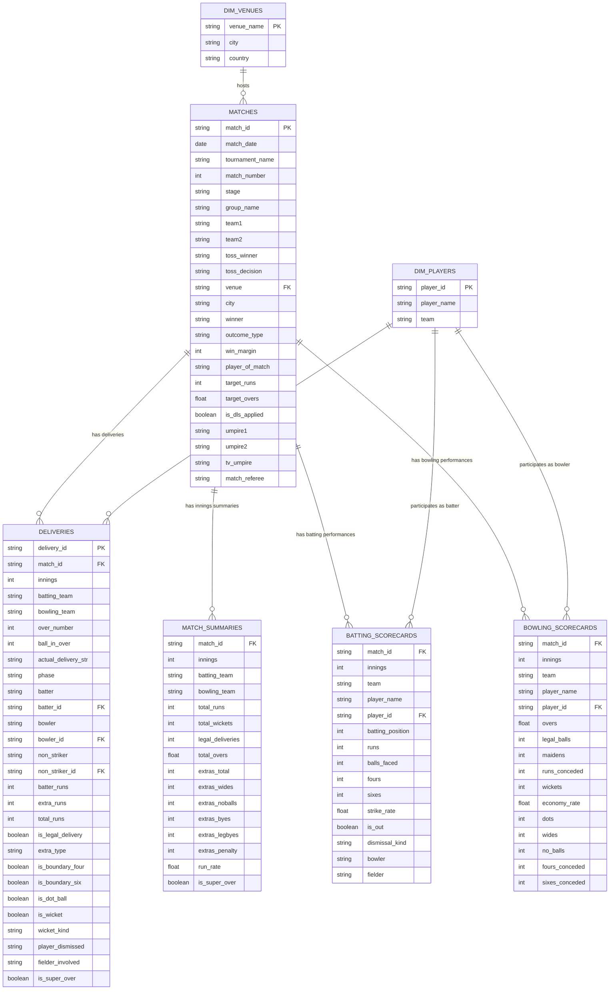

# Data Dictionary: ICC Men's T20 World Cup 2026 Data Analytics

This document defines the schema, data types, constraints, descriptions, and relational keys for all normalized datasets generated in the analytics pipeline.

---

## 1. Entity-Relationship Overview

---

## 2. Table Specifications

### A. `matches` (Match Dimension)
Stores match-level parameters, venue information, match officials, and final results.

| Column | Type | Nullable | Key | Description |
| :--- | :--- | :---: | :---: | :--- |
| `match_id` | VARCHAR(32) | No | PK | Unique identifier assigned by Cricsheet (e.g., `"1512719"`). |
| `match_date` | DATE | No | | Starting date of the match (`YYYY-MM-DD`). |
| `tournament_name` | VARCHAR(100) | No | | Tournament label (`"ICC Men's T20 World Cup"`). |
| `match_number` | INTEGER | Yes | | Scheduled match sequence number (1 through 55). |
| `stage` | VARCHAR(50) | Yes | | Tournament phase (`"Group"`, `"Super 8"`, `"Semi Final"`, `"Final"`). |
| `group_name` | VARCHAR(20) | Yes | | Group assignment (`"A"`, `"B"`, `"C"`, `"D"`, `"1"`, `"2"`). |
| `team1` | VARCHAR(50) | No | | First participating team. |
| `team2` | VARCHAR(50) | No | | Second participating team. |
| `toss_winner` | VARCHAR(50) | No | | Team winning the coin toss. |
| `toss_decision` | VARCHAR(10) | No | | Decision elected at toss (`"bat"` or `"field"`). |
| `venue` | VARCHAR(100) | No | FK | Stadium name where match occurred. |
| `city` | VARCHAR(50) | Yes | | City where venue is located. |
| `winner` | VARCHAR(50) | No | | Winning team or result designation. |
| `outcome_type` | VARCHAR(20) | No | | Margin category (`"runs"`, `"wickets"`, `"tie"`, `"no result"`). |
| `win_margin` | INTEGER | No | | Numeric victory margin (runs or wickets). 0 for ties. |
| `player_of_match` | VARCHAR(100) | Yes | | Awardee(s) of Player of the Match. |
| `target_runs` | INTEGER | Yes | | Target runs required for 2nd innings chase. |
| `target_overs` | NUMERIC(4,1) | Yes | | Target overs allocated for chase (accounts for DLS). |
| `is_dls_applied` | BOOLEAN | No | | Flag indicating if Duckworth-Lewis-Stern method was applied. |
| `umpire1` | VARCHAR(100) | Yes | | First on-field umpire. |
| `umpire2` | VARCHAR(100) | Yes | | Second on-field umpire. |
| `tv_umpire` | VARCHAR(100) | Yes | | Third / Television umpire. |
| `match_referee` | VARCHAR(100) | Yes | | ICC Match Referee presiding over the fixture. |

---

### B. `deliveries` (Fact Deliveries)
Granular ball-by-ball telemetry containing run values, bowling extras, dismissals, and tactical play phases.

| Column | Type | Nullable | Key | Description |
| :--- | :--- | :---: | :---: | :--- |
| `delivery_id` | VARCHAR(64) | No | PK | Surrogate key: `{match_id}_{innings}_{over}_{ball}`. |
| `match_id` | VARCHAR(32) | No | FK | Reference to parent match. |
| `innings` | INTEGER | No | | Innings index (1 or 2, >2 for super overs). |
| `batting_team` | VARCHAR(50) | No | | Team currently batting. |
| `bowling_team` | VARCHAR(50) | No | | Team currently bowling and fielding. |
| `over_number` | INTEGER | No | | Zero-indexed over number (0 to 19). |
| `ball_in_over` | INTEGER | No | | Ball index within the over (1, 2, ...). |
| `actual_delivery_str` | VARCHAR(10) | No | | Cricsheet delivery notation (e.g., `"0.1"`, `"19.6"`). |
| `phase` | VARCHAR(20) | No | | Game phase: `"Powerplay"` (0-5), `"Middle"` (6-14), `"Death"` (15-19). |
| `batter` | VARCHAR(100) | No | | Name of the striker facing delivery. |
| `batter_id` | VARCHAR(32) | No | FK | Unique registry identifier for batter. |
| `bowler` | VARCHAR(100) | No | | Name of the delivery bowler. |
| `bowler_id` | VARCHAR(32) | No | FK | Unique registry identifier for bowler. |
| `non_striker` | VARCHAR(100) | No | | Batter stationed at non-striker's end. |
| `non_striker_id` | VARCHAR(32) | No | FK | Unique registry identifier for non-striker. |
| `batter_runs` | INTEGER | No | | Runs scored off the bat by the striker. |
| `extra_runs` | INTEGER | No | | Extra runs conceded on this delivery. |
| `total_runs` | INTEGER | No | | Combined total runs (`batter_runs + extra_runs`). |
| `is_legal_delivery` | BOOLEAN | No | | True if legal delivery; False if wide or no-ball. |
| `extra_type` | VARCHAR(50) | Yes | | Sub-type of extras (`"wides"`, `"noballs"`, `"byes"`, `"legbyes"`, `"penalty"`). |
| `is_boundary_four` | BOOLEAN | No | | True if batter scored 4 runs off the bat. |
| `is_boundary_six` | BOOLEAN | No | | True if batter scored 6 runs off the bat. |
| `is_dot_ball` | BOOLEAN | No | | True if legal delivery with 0 total runs conceded. |
| `is_wicket` | BOOLEAN | No | | True if a dismissal occurred on this delivery. |
| `wicket_kind` | VARCHAR(50) | Yes | | Method of dismissal (`"caught"`, `"bowled"`, `"lbw"`, `"run out"`, etc.). |
| `player_dismissed` | VARCHAR(100) | Yes | | Name of the player dismissed. |
| `fielder_involved` | VARCHAR(100) | Yes | | Fielder(s) executing catch, run-out, or stumping. |
| `is_super_over` | BOOLEAN | No | | True if delivery occurred in a tiebreaker super over. |

---

### C. `batting_scorecards` (Fact Batting Performance)
Batting summaries per player per innings.

| Column | Type | Nullable | Key | Description |
| :--- | :--- | :---: | :---: | :--- |
| `match_id` | VARCHAR(32) | No | FK | Reference to parent match. |
| `innings` | INTEGER | No | | Innings sequence (1 or 2). |
| `team` | VARCHAR(50) | No | | Batting team name. |
| `player_name` | VARCHAR(100) | No | | Batsman name. |
| `player_id` | VARCHAR(32) | No | FK | Unique registry player ID. |
| `batting_position` | INTEGER | No | | Sequence position when coming to bat (1, 2, ...). |
| `runs` | INTEGER | No | | Total runs scored off the bat. |
| `balls_faced` | INTEGER | No | | Deliveries faced (excluding wides). |
| `fours` | INTEGER | No | | Count of boundaries (4s) hit. |
| `sixes` | INTEGER | No | | Count of maximums (6s) hit. |
| `strike_rate` | NUMERIC(6,2) | No | | Strike rate: `(runs / balls_faced) * 100`. |
| `is_out` | BOOLEAN | No | | True if dismissed; False if not out. |
| `dismissal_kind` | VARCHAR(50) | No | | Mode of dismissal or `"not out"`. |
| `bowler` | VARCHAR(100) | Yes | | Dismissing bowler. |
| `fielder` | VARCHAR(100) | Yes | | Catcher or fielder effecting dismissal. |

---

### D. `bowling_scorecards` (Fact Bowling Performance)
Bowling summaries per player per innings.

| Column | Type | Nullable | Key | Description |
| :--- | :--- | :---: | :---: | :--- |
| `match_id` | VARCHAR(32) | No | FK | Reference to parent match. |
| `innings` | INTEGER | No | | Innings sequence (1 or 2). |
| `team` | VARCHAR(50) | No | | Bowling team name. |
| `player_name` | VARCHAR(100) | No | | Bowler name. |
| `player_id` | VARCHAR(32) | No | FK | Unique registry player ID. |
| `overs` | NUMERIC(4,1) | No | | Completed overs and remainder balls (e.g. `4.0`, `3.2`). |
| `legal_balls` | INTEGER | No | | Count of valid legal deliveries bowled. |
| `maidens` | INTEGER | No | | Number of 6-ball overs completed with 0 runs conceded. |
| `runs_conceded` | INTEGER | No | | Runs charged to bowler (`batter_runs + wides + noballs`). |
| `wickets` | INTEGER | No | | Bowler-credited dismissals (excludes run-outs). |
| `economy_rate` | NUMERIC(5,2) | No | | Runs conceded per 6 legal balls: `runs / (legal_balls / 6)`. |
| `dots` | INTEGER | No | | Number of legal deliveries with 0 runs conceded. |
| `wides` | INTEGER | No | | Wide deliveries bowled. |
| `no_balls` | INTEGER | No | | No-ball deliveries bowled. |
| `fours_conceded` | INTEGER | No | | 4s conceded off the bat. |
| `sixes_conceded` | INTEGER | No | | 6s conceded off the bat. |

---

### E. `match_summaries` (Innings Summary Fact)
Team-level aggregates per innings.

| Column | Type | Nullable | Key | Description |
| :--- | :--- | :---: | :---: | :--- |
| `match_id` | VARCHAR(32) | No | FK | Reference to parent match. |
| `innings` | INTEGER | No | | Innings index (1 or 2). |
| `batting_team` | VARCHAR(50) | No | | Batting side. |
| `bowling_team` | VARCHAR(50) | No | | Bowling / fielding side. |
| `total_runs` | INTEGER | No | | Final score scored by batting team in innings. |
| `total_wickets` | INTEGER | No | | Total wickets lost in innings. |
| `legal_deliveries` | INTEGER | No | | Total legal deliveries bowled in innings. |
| `total_overs` | NUMERIC(4,1) | No | | Formatted overs bowled in innings. |
| `extras_total` | INTEGER | No | | Total extra runs conceded. |
| `extras_wides` | INTEGER | No | | Wide extras. |
| `extras_noballs` | INTEGER | No | | No-ball extras. |
| `extras_byes` | INTEGER | No | | Bye extras. |
| `extras_legbyes` | INTEGER | No | | Leg-bye extras. |
| `extras_penalty` | INTEGER | No | | Penalty extras. |
| `run_rate` | NUMERIC(5,2) | No | | Innings run rate (`total_runs / (legal_deliveries / 6)`). |
| `is_super_over` | BOOLEAN | No | | True if super over innings. |

---

### F. `dim_players` (Player Dimension)
Unique master list of players.

| Column | Type | Nullable | Key | Description |
| :--- | :--- | :---: | :---: | :--- |
| `player_id` | VARCHAR(32) | No | PK | Unique registry identifier or normalized name. |
| `player_name` | VARCHAR(100) | No | | Full player name. |
| `team` | VARCHAR(50) | No | | National team represented. |

---

### G. `dim_venues` (Venue Dimension)
Master stadium catalog with country assignment.

| Column | Type | Nullable | Key | Description |
| :--- | :--- | :---: | :---: | :--- |
| `venue_name` | VARCHAR(100) | No | PK | Official stadium name. |
| `city` | VARCHAR(50) | Yes | | Host city. |
| `country` | VARCHAR(50) | No | | Host nation (`"India"` or `"Sri Lanka"`). |
