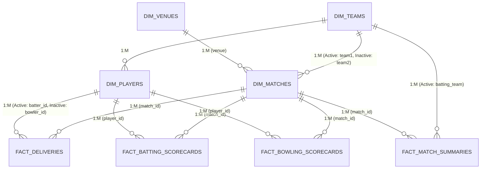

# Power BI Reporting Layer & Semantic Modeling Specification

This document defines the dimensional star schema, table relationships, cross-filter directions, and core DAX business logic designed for Power BI executive dashboards and analytical reports.

---

## 1. Power BI Star Schema Model



---

## 2. Table Relationships & Cardinality

| From Table (Dimension) | From Column | To Table (Fact/Bridge) | To Column | Cardinality | Cross Filter | State |
| :--- | :--- | :--- | :--- | :---: | :---: | :---: |
| `dim_teams` | `team_name` | `dim_matches` | `team1` | 1 : Many | Single | **Active** |
| `dim_teams` | `team_name` | `dim_matches` | `team2` | 1 : Many | Single | *Inactive* |
| `dim_teams` | `team_name` | `dim_players` | `team` | 1 : Many | Single | **Active** |
| `dim_teams` | `team_name` | `fact_match_summaries` | `batting_team` | 1 : Many | Single | **Active** |
| `dim_venues` | `venue_name` | `dim_matches` | `venue` | 1 : Many | Single | **Active** |
| `dim_matches` | `match_id` | `fact_deliveries` | `match_id` | 1 : Many | Single | **Active** |
| `dim_matches` | `match_id` | `fact_batting_scorecards` | `match_id` | 1 : Many | Single | **Active** |
| `dim_matches` | `match_id` | `fact_bowling_scorecards` | `match_id` | 1 : Many | Single | **Active** |
| `dim_matches` | `match_id` | `fact_match_summaries` | `match_id` | 1 : Many | Single | **Active** |
| `dim_players` | `player_id` | `fact_deliveries` | `batter_id` | 1 : Many | Single | **Active** |
| `dim_players` | `player_id` | `fact_deliveries` | `bowler_id` | 1 : Many | Single | *Inactive* |
| `dim_players` | `player_id` | `fact_batting_scorecards` | `player_id` | 1 : Many | Single | **Active** |
| `dim_players` | `player_id` | `fact_bowling_scorecards` | `player_id` | 1 : Many | Single | **Active** |

> [!TIP]
> **Activating Inactive Relationships in DAX**:
> Use `USERELATIONSHIP()` when analyzing bowling metrics through `dim_players` on `fact_deliveries`, e.g.:
> ```dax
> Bowler Total Deliveries = 
> CALCULATE(
>     COUNTROWS(fact_deliveries),
>     USERELATIONSHIP(dim_players[player_id], fact_deliveries[bowler_id])
> )
> ```

---

## 3. Core DAX Measure Calculations

### A. Tournament & Match KPIs
```dax
Total Matches Scheduled = COUNTROWS(dim_matches)

Matches Completed = 
CALCULATE(
    COUNTROWS(dim_matches),
    dim_matches[outcome_type] IN {"runs", "wickets", "tie_super_over"}
)

Matches With Ball By Ball = 
CALCULATE(
    COUNTROWS(dim_matches),
    dim_matches[ball_by_ball_available] = TRUE()
)
```

### B. Batting Performance Measures
```dax
Total Runs Scored = SUM(fact_batting_scorecards[runs])

Total Balls Faced = SUM(fact_batting_scorecards[balls_faced])

Batting Strike Rate = 
DIVIDE(
    [Total Runs Scored],
    [Total Balls Faced],
    0
) * 100

Batting Average = 
VAR TotalDismissals = 
    CALCULATE(
        COUNTROWS(fact_batting_scorecards),
        fact_batting_scorecards[is_out] = TRUE()
    )
RETURN
    DIVIDE([Total Runs Scored], TotalDismissals, [Total Runs Scored])

Boundary Run % = 
VAR BoundaryRuns = 
    SUM(fact_batting_scorecards[fours]) * 4 + SUM(fact_batting_scorecards[sixes]) * 6
RETURN
    DIVIDE(BoundaryRuns, [Total Runs Scored], 0) * 100
```

### C. Bowling Performance Measures
```dax
Total Wickets Taken = SUM(fact_bowling_scorecards[wickets])

Total Runs Conceded = SUM(fact_bowling_scorecards[runs_conceded])

Total Legal Overs Bowled = 
VAR TotalBalls = SUM(fact_bowling_scorecards[legal_balls])
RETURN
    DIVIDE(TotalBalls, 6, 0)

Bowling Economy Rate = 
DIVIDE(
    [Total Runs Conceded],
    [Total Legal Overs Bowled],
    0
)

Bowling Average = 
DIVIDE(
    [Total Runs Conceded],
    [Total Wickets Taken],
    BLANK()
)

Dot Ball % = 
DIVIDE(
    SUM(fact_bowling_scorecards[dots]),
    SUM(fact_bowling_scorecards[legal_balls]),
    0
) * 100
```

### D. Phase & Boundary Telemetry Measures (From `fact_deliveries`)
```dax
Powerplay Runs = 
CALCULATE(
    SUM(fact_deliveries[total_runs]),
    fact_deliveries[phase] = "Powerplay"
)

Death Overs Run Rate = 
VAR DeathRuns = CALCULATE(SUM(fact_deliveries[total_runs]), fact_deliveries[phase] = "Death")
VAR DeathLegalBalls = CALCULATE(COUNTROWS(fact_deliveries), fact_deliveries[phase] = "Death", fact_deliveries[is_legal_delivery] = TRUE())
RETURN
    DIVIDE(DeathRuns, DIVIDE(DeathLegalBalls, 6), 0)
```

---

## 4. Handling Incomplete Data & Coverage Boundaries

In the Power BI visual design:
1. **Tournament Standings & Team Summaries**: Visuals should draw from `fact_match_summaries` and `dim_matches`, covering all 55 scheduled matches and 53 played fixtures.
2. **Phase-by-Phase & Delivery Heatmaps**: Apply a page or visual filter `dim_matches[ball_by_ball_available] = TRUE()` so users are aware these granular metrics reflect the 49 matches with ball-by-ball feeds.
